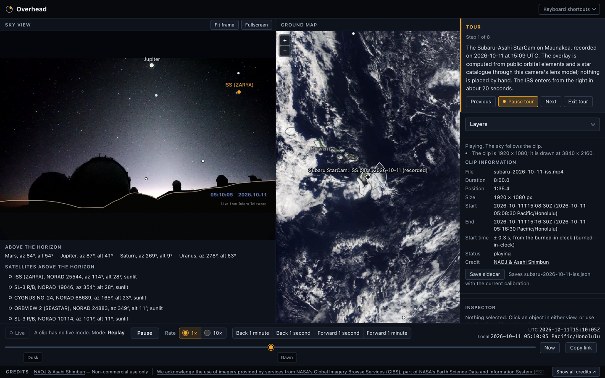
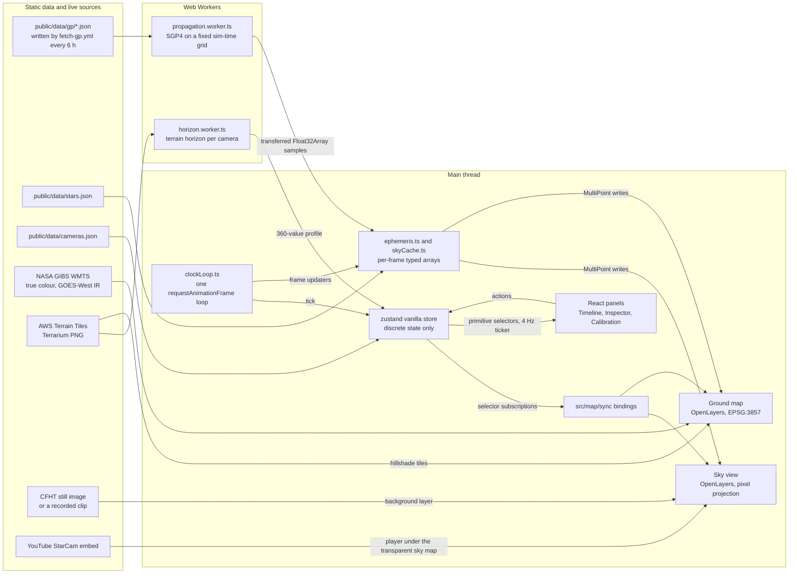

# Overhead

Overhead draws satellites, the ISS, the Moon, planets and bright stars onto live sky-camera video and images, linked to an OpenLayers ground map. A camera at a known place, pointing in a known direction, is a map projection of the sky: anything whose direction can be computed (satellites from orbital elements, planets from ephemerides, stars from a catalogue) can be drawn into its frame. Two views share one clock: the sky view, which is the camera image or video with the computed objects drawn over it, and the ground map, which shows the camera site, ground tracks, the camera's view cast up to orbit height, satellite cloud imagery and terrain. It is built with React, TypeScript, OpenLayers and Zustand on public data, with no API keys and no backend.

Production: **<https://parthjain.ca/Overhead/>**. The guided tour is at <https://parthjain.ca/Overhead/?demo=1>.



Recordings themselves never go in the repository: the deployed clip is a release asset copied in at deploy time ([Deploy](#deploy)).

## Try it

| Link | What it shows |
| ---- | ------------- |
| [`?demo=1`](https://parthjain.ca/Overhead/?demo=1) | The captioned tour: the recorded ISS pass, linked selection, the sensor model, GeoPose, GOES imagery, Starlink, terrain, then the live StarCam |
| [`?cam=subaru-2026-10-11-iss`](https://parthjain.ca/Overhead/?cam=subaru-2026-10-11-iss) | The recorded clip: the ISS crossing the Subaru StarCam on 2026-10-11, with the overlay on the video |
| [`?cam=subaru-2026-10-11-iss&t=2026-10-11T15:11:00Z&sel=sat:25544`](https://parthjain.ca/Overhead/?cam=subaru-2026-10-11-iss&t=2026-10-11T15:11:00Z&sel=sat:25544) | The same clip at media 150 s, with the ISS selected in both views |
| [`?cam=subaru-starcam`](https://parthjain.ca/Overhead/?cam=subaru-starcam) | The live overlay, drawn on the Subaru-Asahi StarCam's YouTube player |
| [`?cam=cfht-nanaao`](https://parthjain.ca/Overhead/?cam=cfht-nanaao) | The CFHT Nānā ao all-sky still image (only at night in Hawaii; the hatch is closed by day) |
| [`?cam=synthetic-walenstadt`](https://parthjain.ca/Overhead/?cam=synthetic-walenstadt) | The computed sky over Walenstadt, under the Churfirsten skyline |
| [`?t=2026-10-11T15:09:50Z&sel=sat:25544`](https://parthjain.ca/Overhead/?t=2026-10-11T15:09:50Z&sel=sat:25544) | The computed sky over Maunakea, paused at a sunlit ISS pass, with the ISS selected |

URL parameters:

| Parameter | Example | Effect |
| --------- | ------- | ------ |
| `cam` | `subaru-starcam` | An enabled camera from `public/data/cameras.json`; any other id falls back to `synthetic-maunakea` |
| `t` | `2026-10-11T15:09:50Z` | Opens paused replay at that UTC time; it must end in `Z`. Without `t` the app starts live |
| `sel` | `sat:25544`, `planet:Jupiter`, `star:424`, `moon`, `sun` | Selects that object on load and follows the selection |
| `demo` | `1` | Starts the tour; leaving the tour removes it |

The Timeline's "Copy link" builds a link to the current view: the camera, the selection, and in replay the current time.

## Architecture



- **One clock.** `clockLoop.ts` runs the only `requestAnimationFrame` loop. The sim time lives in the store, and both maps, the worker requests and the panels follow it. Replay advances by `min(wall delta, 250 ms) × rate`; a live YouTube camera follows the player's media clock minus the stream delay; a recorded clip is its own master clock.
- **Two imperative maps.** Both OpenLayers maps are built and disposed outside React (`registerMap`) and driven by the bindings in `src/map/sync`, which subscribe to store selectors. The sky view is an OpenLayers map in the camera's pixel projection; the ground map is EPSG:3857.
- **Workers own the math.** SGP4 runs in `propagation.worker.ts` on a fixed sim-time grid (`t = k × 100 ms × rate`), one sample ahead, and ships transferred `Float32Array` samples; the same worker runs the 60 s "incoming" look-ahead. `horizon.worker.ts` marches the terrain horizon for each camera.
- **High-rate data stays out of the store.** Positions live in typed arrays in `ephemeris.ts` and `skyCache.ts`, interpolated every frame and written in place into one `MultiPoint` per group and style class, with one `changed()` per frame. The store holds discrete state only: clock, camera, selection, layers, load statuses.
- **React renders at 4 Hz.** Panels read the store through primitive selectors, and one shared 4 Hz ticker feeds every time readout. While playing with no input a production build commits nothing and a development build 4.0 times a second (M9 step 5).

## Talking points

- **A camera is a map projection.** A rectilinear lens is the gnomonic projection, and the fisheyes are azimuthal (equidistant, equisolid, stereographic, orthographic). The closed forms match proj4 to < 1e-9 for the zenith fisheye and to a relative 1e-12 for every lens and pose, and each has a closed-form inverse (`lens.test.ts`, `inverse.test.ts`).
- **Same math as ISR video annotation.** A sensor pose plus a lens model turns a known position into a pixel, and a pixel back into a ray: the projection behind telemetry overlays on aerial video.
- **Space domain awareness.** A ground sensor is checked against the public catalogue: on the recorded pass the drawn ISS marker stays within 1.0° of the ISS at all 94 tracked seconds (max 0.54°, median 0.27°; `scripts/check-clip-pass.ts`).
- **Two-step calibration.** Stars move 15.04°/h, slowly enough to fix the pointing; the ISS crosses about 0.99°/s at a 76.9° pass, fast enough to fix the time. The 2026-10-11 clip took its pointing from 73 stars (0.0415° rms per pair) and its time from the camera's burned-in clock.
- **Performance by design.** Culling keeps the Starlink sample at p95 2.1–2.6 ms against 5.8–8.5 ms for the plain loop; the sky cut-off and interleaved ground updates take the 4× CPU frame from 55 fps (p95 18.4 ms) to 60 fps (p95 11.8 ms); React commits 0 times a second while playing in production ([Performance](#performance)).
- **OGC standards.** WMTS with a `Time` dimension (GIBS true colour and GOES-West infrared every 10 minutes), and the camera pose exported as OGC GeoPose 1.0 Basic-YPR, validated against the vendored official schema.
- **Sky over video.** The sky map is drawn on the YouTube player and on the recorded clip, light by design: the ISS and the other stations and visual satellites, a few bright stars, the Moon and planets. The ground map carries the dense data. The player keeps its own controls through `pointer-events: none` on the map and `ol/Overlay` button hit targets.
- **Measured on the recorded pass.** With the star fit (73 stars, 0.0415° rms per pair) and the burned-in clock, the ISS marker sits 1.2 px rms from the ISS on the 1920 × 1080 frame when the element set is 20 h old (the clip sidecar's `timingSource`).
- **Engineering constraints.** The site is static on GitHub Pages under `/Overhead/`, so the recorded clip ships as a 22.4 MiB copy with the element sets from near its pass; a clip served without byte ranges is read into a Blob so it can seek; the YouTube stream runs about 50 s behind real time; GIBS keeps GOES imagery for 90 days.

## Performance

Budgets ([implementation README section 9](docs/implementation/README.md#9-performance-budgets)), all measured in Chromium through Playwright, never in Node and never in CI:

| Work | Budget | Latest measured |
| ---- | ------ | --------------- |
| Main thread per frame, Starlink loaded, 60× | ≥ 59 fps and p95 ≤ 6 ms; at 4× CPU ≥ 55 fps and p95 ≤ 16 ms | 59.9–60.0 fps, p95 3.5 ms; at 4× 59.1–59.3 fps, p95 14.4–14.9 ms † |
| Propagation worker, stations + visual | p95 ≤ 4 ms per sample | p95 0.20 ms (175 objects) |
| Propagation worker, with Starlink | p95 ≤ 10 ms per sample | culled: p95 2.1–2.6 ms at 1× to 60×, 4.1–5.1 ms at 600× † |
| Incoming look-ahead, with Starlink | p95 ≤ 20 ms | p95 12.20 ms |
| Sky recompute at V ≤ 6.5 and 600× | p95 ≤ 2 ms | p95 1.90 ms |
| React commits while playing | ≤ 4 per second | 0 (production build), 4.0 (development build) † |

Rows marked † come from the M9 measurement run described below; the others from the app's own `npm run perf` on 2026-10-11 (M5–M8, Chromium headless shell, arm64).

The tables below were measured on 2026-10-11 for the M9 implementation doc, on a prototype of the M9 performance changes (WebGL class points on the ground map, canvas class points in the sky, a star pass every 2 s of sim time, both maps rendered every frame; no imagery, panels or tracks): an Apple M2 (8 cores), Chrome for Testing 156.0.8078.4 in new headless mode on ANGLE Metal at DPR 2 and 1440 × 900, driven by Playwright 1.64.0 from the arm64 Node 26.11.1, on the 2026-10-11T03:50:21Z CelesTrak snapshot (11,277 objects). Ranges cover two independent runs. `npm run perf` measures the app itself.

**Starlink culling in the worker** (300 samples per run). Each sample propagates every station and visual satellite, one tenth of Starlink, and every Starlink that could rise above −10° before its slice comes round again; the other rows move along their held Earth-fixed velocity. Checked against a full pass, every object above −5° was identical (0 differences in 59,193 checks at 60× and 61,703 at 600×).

| Rate | Objects propagated per sample (p50) | `computeMs` p50 / p95 / max |
| ---- | -----------------------------------: | --------------------------- |
| 1× | 2,236 | 1.9–2.1 / 2.1–2.6 / 2.1–2.9 ms |
| 60× | 2,562 | 1.9–2.3 / 2.1–2.5 / 2.3–3.6 ms |
| 600× | 6,820–6,821 | 3.8–4.6 / 4.1–5.1 / 5.2–5.4 ms |
| plain loop, 60×, all 11,267 | 11,267 | 5.5–7.6 / 5.8–8.5 / 6.7–9.3 ms |

**Main-thread frame** (`overhead:frame`, Starlink at 60×, ms). The sky skips Starlink rows below −3° geometric, and Starlink ground positions update at 30 Hz, interleaved by index parity (never the selected or hovered object).

| Path | CPU 1×: p50 / p95 / max, fps | CPU 4×: p50 / p95 / max, fps |
| ---- | ---------------------------- | ---------------------------- |
| M3 path | 4.8 / 5.8 / 6.6, 60.0 | 15.7 / 18.4 / 25.8, 55.0 (101 frames > 20 ms) |
| + sky cut-off | 4.2 / 5.4 / 5.7, 60.0 | 14.0 / 16.9 / 23.2, 59.2 (16 frames > 20 ms) |
| + interleave | 3.6 / 4.6 / 5.2, 60.0 | 9.4 / 11.8 / 14.7, 60.0 (0 frames > 20 ms) |

**Traces** (`starlink.perf.ts`, 10 s each, Starlink loaded, 60×):

| CPU | fps | frame p95 | frame max | propagate p95 |
| --- | --- | --------- | --------- | ------------- |
| 1× | 59.9–60.0 | 3.5 ms | 5.6–6.8 ms | 1.8–1.9 ms |
| 4× | 59.1–59.3 | 14.4–14.9 ms | 23.0–26.1 ms | 2.3–2.4 ms |

CDP throttling slows the main thread only, so the 4× trace says nothing about the worker. Every 4× trace holds one 129–147 ms task that is a throttling or tracing artifact (about 100 ms of `V8.InvokeApiInterruptCallbacks`); any other main-thread task over 50 ms is a real failure.

Reproduce on a native arm64 laptop (stop any running `npm run preview` first: a reused server keeps serving `dist/`):

```sh
npx playwright install chromium                     # Chrome for Testing; the headless shell renders WebGL on SwiftShader
npm run build && npm run perf -- starlink           # test-results/perf/starlink-{1,4}x.json and trace-{1,4}x.json
npm run perf -- propagation                         # worker time per sample, with and without Starlink
npm run perf -- sky                                 # overhead:sky pass at V ≤ 6.5 and 600×
npm run perf -- incoming                            # the incoming look-ahead with Starlink
npm run build:dev && PERF_OUTDIR=dist-dev npm run perf -- commits   # React commits on the development build
```

## Keyboard shortcuts

Every key also has an on-screen control. The handler ignores keys typed into inputs, keys on a focused map (where the arrows pan; Esc still clears the selection), prevented events and Alt, Ctrl or Meta chords, and Space presses a focused button. The same table is on screen under "Keyboard shortcuts".

| Key | Effect | Notes |
| --- | ------ | ----- |
| Space | `togglePlay()` | |
| ← / → | `stepBy(∓1000)` | Shift: ∓60,000 ms; off while Calibration is open |
| `[` / `]` | previous / next offered rate | 1, 10, 60, 600; 1 and 10 with a clip (M5) |
| L | `togglePanel("layers")` | |
| C | `togglePanel("calibration")` | |
| ← → ↑ ↓ with Calibration open | `azDeg` ∓0.05° (`rollDeg` on a zenith-locked fisheye); `altDeg` ±0.05° | Shift: 0.5° |
| Esc | tour active → `stopDemo()`; else pending point → `cancelImagePoint()`; else `select(null)` | first match only |
| arrows, `+`, `−` on a focused map | pan and zoom | OpenLayers `KeyboardPan` and `KeyboardZoom` defaults |

## Accessibility

- Every control is reachable with the keyboard and shows a visible focus ring; the browser's ring is never removed without a replacement.
- Pointer targets are at least 24 × 24 CSS px, OpenLayers' control buttons included. The hit targets over the video are named buttons but not tab stops: keyboard users select the Sun, Moon, planets and satellites from the sky view's text alternative, the "Above the horizon" list and the "Satellites above the horizon" buttons.
- `prefers-reduced-motion: reduce` turns trails off (their toggle reads "(off: reduced motion)"), makes "Show on map" and Follow jump instead of animating, turns CSS transitions and animations off, and changes tour steps without animation.
- Meaning never rides on colour alone: sunlit and shadowed satellites differ in shape, and camera statuses, "Behind terrain", "Imagery as of" and the incoming chip are text.
- One `<main>`, named `<section>` regions, and an `aria-label` on each map container; a map that takes keyboard pan and zoom is focusable (`role="application"`). Live regions announce changes, never a ticking value: the incoming chip announces only a new first entry, and the tour holds its caption in one polite region.

Lighthouse 13.5.0 accessibility, run by hand (`npx --yes lighthouse@13.5.0 … --only-categories=accessibility`, [M9 step 11](docs/implementation/M9-polish-ship.md#step-11-accessibility-pass)); the gate is ≥ 90 on every run:

| URL | Desktop | Mobile |
| --- | ------: | -----: |
| `/Overhead/?cam=synthetic-maunakea&t=2026-10-11T15:09:50Z` | pending | pending |
| the same with `&sel=sat:25544` | pending | pending |
| `/Overhead/?demo=1` | pending | pending |
| `https://parthjain.ca/Overhead/` (production) | pending | |

Lighthouse cannot open panels, so the panel states are covered by `tests/e2e/a11y.spec.ts`.

## Credits

Every source is credited on screen while it is visible, in the always-visible Credits region; the active camera's credit and terms are shown at all times.

- **NASA GIBS** (true colour, coastlines, labels and GOES-West imagery): "We acknowledge the use of imagery provided by services from NASA's Global Imagery Browse Services (GIBS), part of NASA's Earth Science Data and Information System (ESDIS)." ([GIBS](https://nasa-gibs.github.io/gibs-api-docs/)). Instrument lines: "Imagery: NOAA-20 / VIIRS" (true colour) and "Imagery: GOES-West/ABI, Band 13 Clean Infrared" (while the GOES layer is on).
- **Coastlines and place labels:** [© OpenStreetMap contributors, Natural Earth](https://www.openstreetmap.org/copyright), licence [ODbL-1.0](https://opendatacommons.org/licenses/odbl/).
- **Terrain:** [Terrain: AWS Terrain Tiles (Tilezen Joerd), data sources and attribution](https://github.com/tilezen/joerd/blob/master/docs/attribution.md), shown with the dataset's full "Required attribution" block while terrain is in use:
  - ArcticDEM terrain data DEM(s) were created from DigitalGlobe, Inc., imagery and funded under National Science Foundation awards 1043681, 1559691, and 1542736
  - Australia terrain data © Commonwealth of Australia (Geoscience Australia) 2017
  - Austria terrain data © offene Daten Österreichs – Digitales Geländemodell (DGM) Österreich
  - Canada terrain data contains information licensed under the Open Government Licence – Canada
  - Europe terrain data produced using Copernicus data and information funded by the European Union - EU-DEM layers
  - Global ETOPO1 terrain data U.S. National Oceanic and Atmospheric Administration
  - Mexico terrain data source: INEGI, Continental relief, 2016
  - New Zealand terrain data Copyright 2011 Crown copyright (c) Land Information New Zealand and the New Zealand Government (All rights reserved)
  - Norway terrain data © Kartverket
  - United Kingdom terrain data © Environment Agency copyright and/or database right 2015. All rights reserved
  - United States 3DEP (formerly NED) and global GMTED2010 and SRTM terrain data courtesy of the U.S. Geological Survey.
- **Orbital elements:** [Orbital elements: CelesTrak](https://celestrak.org), shown while the Satellites or Starlink layer is on. The elements are fetched by `fetch-gp.yml` under CelesTrak's usage policy: at most once per group every 2 h, stopping at the first error.
- **Stars** (shown while the Stars layer is on): [Bright Star Catalogue, 5th Revised Ed. (Hoffleit & Warren 1991), via CDS VizieR](https://doi.org/10.26093/cds/vizier) (DOI 10.26093/cds/vizier), and [Star names: IAU WGSN](https://www.pas.rochester.edu/~emamajek/WGSN/IAU-CSN.txt) (CC BY).
- **Cameras**, each credit with its terms exactly as in `public/data/cameras.json`, shown while the camera is active:
  - `synthetic-maunakea` and `synthetic-walenstadt`: "Computed sky (no camera image)".
  - `cfht-nanaao`: "[Nānā ao all-sky image © CFHT](https://www.cfht.hawaii.edu/en/gallery/nanaao.php)", GFDL-1.3-or-later: "GNU Free Documentation License 1.3 or later" ([licence](https://www.gnu.org/licenses/fdl-1.3.html)).
  - `subaru-starcam`: "NAOJ & Asahi Shimbun", "Non-commercial use only".
  - `cfht-starcam`: "CFHT & Asahi Shimbun in collaboration with Subaru Telescope, NAOJ", "Non-commercial use only".
  - `subaru-2026-10-11-iss`, the recorded clip: "NAOJ & Asahi Shimbun" (its sidecar's credit, linked to the source video), "Non-commercial use only".
  - `local-replay`: "Local clip: credit comes from its sidecar", "Played from this device only; never uploaded".
  - AllSkyKamera ASK053 (Walenstadt) is not enabled; it will be only with the owner's written permission.
- **GeoPose schema:** `src/domain/camera/schemas/GeoPose.Basic.YPR.Schema.json`, © 2022 Open Geospatial Consortium, Apache-2.0 ([`PROVENANCE.md`](src/domain/camera/schemas/PROVENANCE.md)).
- **Code:** OpenLayers 10.11.0 (BSD-2-Clause); React 19.3.0, zustand 5.0.15, satellite.js 7.1.0, astronomy-engine 2.1.19, ajv 8.20.0, and proj4 2.22.0 for tests only (all MIT).

`tests/unit/readme.test.ts` checks this section against `src/app/credits.ts` and `public/data/cameras.json`.

## Development

### Requirements

- Node 26, arm64. Run `nvm use` (it reads `.nvmrc`), then check that `node -p process.arch` prints `arm64`.
- `npm ci` to install the pinned dependencies.
- `npx playwright install chromium` once (Playwright 1.64 needs Chromium 1248). Without `--only-shell` it installs both the headless shell, which the end-to-end tests use, and Chrome for Testing, which `npm run perf` needs.

### Scripts

| Script | What it does |
| ------ | ------------ |
| `npm run dev` | Vite dev server at `http://localhost:5173/Overhead/`. It serves the project root, so `recordings/` loads as it is |
| `npm run build` | `tsc -b`, then `vite build` into `dist/` |
| `npm run build:dev` | `NODE_ENV=development vite build --mode development --outDir dist-dev`: the development React build that `commits.perf.ts` counts commits on |
| `npm run build:pages` | `npm run build`, then `scripts/fetch-deploy-clips.ts`: the deploy build with the recorded clip and its element sets in `dist/recordings/` ([Deploy](#deploy)). Only `deploy.yml` runs it |
| `npm run preview` | serves the last build with `vite preview` at `http://localhost:4173/Overhead/` |
| `npm run typecheck` | `tsc -b` over the four project references |
| `npm test` | Vitest unit tests (`tests/unit`) |
| `npm run e2e` | Playwright end-to-end tests (`tests/e2e`), headless Chromium against `vite preview`. It serves the last `npm run build`, so build first. |
| `npm run perf` | Playwright performance specs (`tests/perf`), run by hand on a native arm64 laptop, never in CI, on Chrome for Testing with the GPU at 1440 × 900, DPR 2. Like `npm run e2e` it serves the last `npm run build`, so build first; `PERF_OUTDIR=dist-dev` serves `npm run build:dev`'s output instead. Run one spec with `npm run perf -- <name>`: `starlink` (frame budget and traces), `propagation` (the worker's time per sample, for ISS + visual and with Starlink, both gated), `sky` (the `overhead:sky` pass p95 at V ≤ 6.5 and 600×, budget ≤ 2 ms), `incoming`, `commits` and `screens` |
| `npm run lint` | `biome ci --error-on-warnings .` |
| `npm run format` | `biome check --write .` |

### Orbital elements

Orbital elements are OMM JSON from CelesTrak in `public/data/gp/` (`stations.json`, `visual.json`, `starlink.json`, and `meta.json` with each group's fetch time, record count and sha256). The app fetches only these files from its own origin. They are refreshed by `.github/workflows/fetch-gp.yml`, every 6 h and by hand (`workflow_dispatch`):

- It runs `GP_CONTACT_URL=<repository URL> npx tsx scripts/fetch-gp.ts --out public/data/gp`, which sends `User-Agent: overhead-fetch-gp/1.0 (+<repository URL>)` and always asks for `FORMAT=json`.
- Each group is skipped while its `meta.json` stamp is under 2 h old. The groups are fetched one at a time, and the run stops at the first non-200 answer (CelesTrak's 403 "not updated since your last download" included), never following a redirect and never retrying: CelesTrak firewalls an address after 50 errors in 2 h. A group file is rewritten only when its sha256 changes; its stamp is always refreshed.
- Exit codes: 0 when every group was fetched or skipped, 1 after a stop (`Stopped: <error>`) or a corrupt `meta.json`, 2 on bad arguments or a missing or invalid `GP_CONTACT_URL`.
- The workflow then commits only changed files under `public/data/gp/`, also after a stop (the groups fetched before it are kept), and, on `main`, dispatches the Deploy workflow, because a push made with the workflow token starts no other workflow.
- Never run the script from a dev machine or a test: every run counts against CelesTrak's limits. Unit tests use a fake `fetch`, and e2e serves `tests/fixtures/gp/` for `data/gp/*.json`, so positions in tests never change.

### Fixtures and generated data

Network tools run by hand on a developer machine and commit their output; CI never runs them.

The GIBS capabilities snapshot `public/data/gibs-capabilities.xml` is trimmed from live GIBS by a script, run by hand only when a layer id or matrix set changes (CI never reaches GIBS):

```sh
npx tsx scripts/fetch-gibs-caps.ts            # writes public/data/gibs-capabilities.xml
```

The e2e tile stubs were downloaded once: a real NOAA-20 tile, and the 155 B fully transparent PNG that GIBS returns for any KVP `Reference_Labels` request, which stands in for every overlay tile so no OSM data is committed:

```sh
mkdir -p tests/fixtures/gibs
B='https://gibs.earthdata.nasa.gov/wmts/epsg3857/best/wmts.cgi?style=default&tilematrixset=GoogleMapsCompatible_Level9&Service=WMTS&Request=GetTile&Version=1.0.0&TileMatrix=5&TileCol=2&TileRow=14'
curl -fo tests/fixtures/gibs/tile.jpg "$B&layer=VIIRS_NOAA20_CorrectedReflectance_TrueColor&Format=image%2Fjpeg&Time=2026-10-10"
curl -fo tests/fixtures/gibs/tile.png "$B&layer=Reference_Labels&Format=image%2Fpng"
```

The GOES e2e fixture `tests/fixtures/gibs/goes-domain.xml` is the DescribeDomains window 2026-10-07T12:00Z to 2026-10-11T00:00Z, which holds two real gaps. Refetch it by hand only when the format changes:

```sh
curl -o tests/fixtures/gibs/goes-domain.xml 'https://gibs.earthdata.nasa.gov/wmts/epsg3857/best/1.0.0/GOES-West_ABI_Band13_Clean_Infrared/default/GoogleMapsCompatible_Level6/all/2026-10-07T12:00:00Z--2026-10-11T00:00:00Z.xml'
```

`public/data/stars.json` (8,404 stars at V ≤ 6.5, brightest first) is built by hand from CDS V/50 and the IAU-CSN name list. Commit only the output. The script prints its summary line with both inputs' sha256s:

```sh
npx tsx scripts/build-stars.ts                                         # downloads both inputs
npx tsx scripts/build-stars.ts --catalog <catalog.gz> --csn <IAU-CSN.txt>   # local copies
```

The planet test fixture `tests/fixtures/horizons-airless-maunakea-2026-10-10.json` holds JPL Horizons AIRLESS az/el tables for the Sun, Moon and six planets at Maunakea on 2026-10-10. It is fetched once with the script below, which makes eight requests to the Horizons API, 500 ms apart. Unit tests and CI only read the committed file.

```sh
npx tsx scripts/fetch-horizons-fixture.ts
```

The test snapshot in `tests/fixtures/gp/` is CelesTrak's data of 2026-10-11T03:50:21Z (22 stations, 156 visual and 11,102 Starlink records; 11,277 unique objects). The ISS reference fixture `tests/fixtures/iss-pass-maunakea.json` (Skyfield passes over Maunakea in the 24 h after that fetch) is regenerated by hand whenever the snapshot changes. It needs `uv`, and downloads DE421 (17 MB) once into `~/.cache/skyfield`. Two runs give byte-identical output:

```sh
uv run --with skyfield==1.55 --with sgp4==2.27 python scripts/fixtures/iss-pass-skyfield.py
# 3 passes, 93 samples, 31 shadow transitions -> <path>/tests/fixtures/iss-pass-maunakea.json
```

The real-frame calibration fixture `tests/fixtures/calibration/subaru-clip-pairs.json` (350 star pairs from three moments of the recorded 2026-10-11 Subaru clip) is rebuilt from the clip; it needs an ffmpeg binary, and two runs give the same bytes:

```sh
npx tsx scripts/fixtures/clip-pairs.ts --ffmpeg <path to ffmpeg>
```

The e2e test clip `tests/fixtures/video/test-pattern.webm` and its sidecar are generated, byte for byte:

```sh
npx tsx scripts/fixtures/make-test-clip.ts --ffmpeg <path to ffmpeg>
```

The terrain fixtures in `tests/fixtures/terrain/` were fetched once, by hand, and are committed; tests never touch the network. `walenstadt/` is every tile of that site's 100 km march; `maunakea/` is only the Subaru StarCam's open-ocean ray at azimuth 0°, plus `flat.png`, a 256 × 256 sea-level tile. To rebuild them:

```sh
npx tsx scripts/fetch-terrain-fixture.ts
# walenstadt: 45 tiles, 5.58 MB
# maunakea: 10 tiles, 1.15 MB
```

The GeoPose schema in `src/domain/camera/schemas/` is OGC's file, vendored byte for byte (© Open Geospatial Consortium, Apache-2.0) and never fetched at runtime. Check the copy against the original with:

```sh
curl -sS -o GeoPose.Basic.YPR.Schema.json https://schemas.opengis.net/geopose/1.0/schemata/GeoPose.Basic.YPR.Schema.json
shasum -a 256 GeoPose.Basic.YPR.Schema.json   # 5508d26aed6f546384ac1e1b9d1117f201179a2b32200ad28af3e5209c765640
```

### Recording a clip

Recordings never enter git. A clip is `recordings/<clip>.mp4` plus its sidecar `recordings/<clip>.json` (start time from the burned-in clock, calibration from a star fit) and `recordings/<clip>.gp/` (the element sets of that day, which the app replays the clip with). The clip tools run by hand, never in CI:

```sh
npx tsx scripts/find-passes.ts --cam subaru-starcam --hours 48        # next ISS spans inside the frame
npx tsx scripts/record-clip.ts --cam subaru-starcam --from <ISO Z> --to <ISO Z> --name <clip>   # within ~1 h
npx tsx scripts/check-clip-pass.ts --cam subaru-2026-10-11-iss \
  --track tests/fixtures/video/subaru-2026-10-11-iss-track.json --gp tests/fixtures/gp   # against `npm run dev`
```

- `find-passes.ts` lists the spans when a satellite is inside a camera's frame; start a recording at least 60 s before entry (the incoming look-ahead) and end it after exit.
- `record-clip.ts` needs `yt-dlp` and an ffmpeg. It cuts the window from the stream's DVR window after the fact, within about an hour (never at the live edge), remuxes it to MP4, writes the sidecar, and copies `public/data/gp/` into `recordings/<clip>.gp/`.
- `check-clip-pass.ts` drives a headless Chromium and passes when every one of the 94 track samples has the drawn marker within 1.0°. `--gp <dir>` routes the app's element-set requests to `<dir>`; without it, nothing is routed.

### Visual design screenshots

`tests/perf/screens.perf.ts` saves 52 full-page screenshots (4 viewports × 12 states, the tour's intro and step 1 as two) to `test-results/screens/<viewport>/`, on the shared e2e fixtures, and `scripts/contact-sheet.ts` tiles each viewport's set into one sheet with ffmpeg:

```sh
npm run build && npm run perf -- screens
npx tsx scripts/contact-sheet.ts --ffmpeg <path to ffmpeg>   # test-results/screens/contact-sheet-<viewport>.png
```

### Deploy

GitHub Pages, deployed from GitHub Actions (public repository `FalconXYX/Overhead`). `.github/workflows/deploy.yml` builds `main` with `npm ci` and `npm run build:pages` into `dist/`, using Node from `.nvmrc`, and publishes it on every push to `main` and on `workflow_dispatch` (which `fetch-gp.yml` uses after a data commit). Vite's `base` is `/Overhead/` (Pages paths are case-sensitive and follow the repo name).

- Production: `https://parthjain.ca/Overhead/`. `parthjain.ca` is the `FalconXYX.github.io` user site, so project sites appear under it.
- No per-branch previews: CI checks every pull request (`ci.yml` builds with plain `npm run build` and never downloads the clip), and `npm run build && npm run preview` shows a build locally at `http://localhost:4173/Overhead/`. A local build has no `recordings/`, so the clip camera reports "This clip is not part of this build" and the tour runs on the computed sky.
- Pages is enabled with Source: **GitHub Actions** (done 2026-10-11).

**The recorded clip in production.** The deployed build serves the 2026-10-11 clip from its own origin, so `?demo=1` opens on it and the canvas stays readable without CORS. GitHub Pages answers byte ranges with 206, so the video streams and seeks from its URL.

1. **Deploy copy.** A two-pass x264 copy of the 148,643,811-byte master, at 390 kbit/s with the master's size, frame rate, timing and GOP: 23,515,809 bytes (22.43 MiB), under the 25 MiB ceiling that keeps a full play to a sixth of the master's bandwidth (GitHub Pages' soft limit is 100 GB a month). Made once per clip from the project root with ffmpeg 7.1 (`$FFMPEG`), into the gitignored `recordings/web/`:

   ```sh
   mkdir -p recordings/web
   "$FFMPEG" -hide_banner -nostdin -y -i recordings/subaru-2026-10-11-iss.mp4 -map 0:v:0 -an \
     -c:v libx264 -preset slow -b:v 390k -profile:v high -level:v 4.0 -pix_fmt yuv420p -g 150 \
     -pass 1 -passlogfile recordings/web/x264 -f null /dev/null
   "$FFMPEG" -hide_banner -nostdin -y -i recordings/subaru-2026-10-11-iss.mp4 -map 0:v:0 -an \
     -c:v libx264 -preset slow -b:v 390k -profile:v high -level:v 4.0 -pix_fmt yuv420p -g 150 \
     -pass 2 -passlogfile recordings/web/x264 -movflags +faststart recordings/web/subaru-2026-10-11-iss.mp4
   cp recordings/subaru-2026-10-11-iss.json recordings/web/
   rm recordings/web/x264*
   shasum -a 256 recordings/web/subaru-2026-10-11-iss.*
   ```

   The sidecar is copied unchanged. The hashes depend on the encoder build, so `DEPLOY_CLIP_FILES` in `scripts/fetch-deploy-clips.ts` takes `bytes` and `sha256` from the files actually uploaded; recompute the sidecar's whenever it changes ("Save sidecar", a new timing check).
2. **Release.** Both files are assets of the release `clips-2026-10-11` on `FalconXYX/Overhead`. The repository is public, so they download without a token, and a release asset is not part of git history:

   ```sh
   gh release create clips-2026-10-11 recordings/web/subaru-2026-10-11-iss.mp4 recordings/web/subaru-2026-10-11-iss.json \
     --repo FalconXYX/Overhead --title "Recorded clips, 2026-10-11" --notes "Deploy copies of recordings/subaru-2026-10-11-iss (step 14 of M9)."
   ```

3. **Build.** `npm run build:pages` downloads each file in `DEPLOY_CLIP_FILES` into `dist/recordings/`, checking its size and sha256, and copies each clip's element sets (`DEPLOY_CLIP_GP`; for this clip the committed `tests/fixtures/gp/`, fetched 11.3 h before the pass) into `dist/recordings/<clip>.gp/`, checking each group file against `meta.json`. Any failure names the file and fails the deploy, and production keeps its last deploy.
4. **Element sets.** While a clip camera is active the app propagates the clip's own `recordings/<clip>.gp/`, not the 6-hourly `data/gp/`, so the ISS marker stays where it was on the day: with sets 20 h, 11 h and 40.3 h old the ISS ran 0.08 s, 0.30 s and 0.88 s behind the clip, and 2.9 s behind with a 3.7-day-old ephemeris.
5. **A new clip:** repeat steps 1 and 2 under a new tag, add its two entries to `DEPLOY_CLIP_FILES` and its GP directory to `DEPLOY_CLIP_GP`, and add its `local-video` entry to `public/data/cameras.json`.

Check production after a deploy (allow up to 10 minutes for `cache-control: max-age=600`):

```sh
curl -sI https://parthjain.ca/Overhead/recordings/subaru-2026-10-11-iss.mp4                     # 200, video/mp4, content-length 23515809, accept-ranges: bytes
curl -sI -H "Range: bytes=0-1" https://parthjain.ca/Overhead/recordings/subaru-2026-10-11-iss.mp4   # 206
curl -sI https://parthjain.ca/Overhead/recordings/subaru-2026-10-11-iss.gp/stations.json        # 200, content-length 9293
```

## Documentation

- [Implementation contracts](docs/implementation/README.md) and the per-milestone build steps
- [Decisions](docs/DECISIONS.md)
- The claim-by-claim verification records behind those decisions (`docs/verification/`) are kept locally and are not published.

## Milestones

- [x] M0 · Scaffold
- [x] M1 · Ground map
- [x] M2 · Synthetic sky
- [x] M3 · Satellites
- [x] M4 · Camera model and still images
- [x] M5 · Live video
- [x] M6 · Terrain
- [x] M7 · Weather imagery
- [x] M8 · Footprint and alerts
- [ ] M9 · Polish and ship

### M0 · Scaffold

- Every quality gate (lint, typecheck, unit tests, build, e2e) runs in CI on Node 26 against an empty app.
- The shell shows three placeholder panes (Sky view, Ground map, Timeline), each inside its own error boundary.
- The whole store is in place, with the replay clock loop and Play/Pause; every later action is a placeholder that throws.

### M1 · Ground map

- The ground map (EPSG:3857, OpenLayers) shows NASA GIBS daily true colour from NOAA-20 VIIRS (`VIIRS_NOAA20_CorrectedReflectance_TrueColor`), the GIBS `Coastlines` and `Reference_Labels` overlays, and a labelled marker at the active camera's site. The view starts at zoom 6 centred on the site. `Reference_Labels` is requested through its REST tile templates: GIBS answers every KVP `GetTile` for it with the same transparent tile. The time-enabled layers use KVP.
- The true-colour `Time` follows the clock: it is the UTC date of the latest 13:30 local-mean-solar-time pass (NOAA-20's afternoon pass) at the site that is at least 4 h old, counted from the sim time or the real clock, whichever is earlier (a pass that has not happened yet has only black tiles). At Maunakea it flips at 03:51:52.5Z. A `Time` whose tiles fail reverts to the last one that loaded and is never selected again in the session.
- The Timeline has Live, Play/Pause, rates 1×/10×/60×/600×, ±1 s and ±1 min steps, a ±12 h scrubber, Now, and UTC and camera-local readouts. The Layers panel toggles true colour and the overlays. Credits are on screen at all times.
- Keys: Space play/pause, ← → step 1 s (Shift: 1 min), `[` `]` previous/next rate, `L` Layers. They do nothing inside inputs or on the focused map (where the arrows pan), and Space presses a focused button.
- URL: `?t=2026-10-10T03:30:00Z` (UTC, must end in `Z`) opens paused replay at that time; without `t` the app starts live. `?cam=<id>` picks an enabled camera from `public/data/cameras.json`; only `synthetic-maunakea` is enabled in M1, and any other id falls back to it.
- The capabilities snapshot and the e2e tile stubs are described under [Fixtures and generated data](#fixtures-and-generated-data).

### M2 · Synthetic sky

- The Sky view draws the sky over the active camera's site at the clock's sim time, as a zenith fisheye (equidistant, horizon on the frame edge) seen from below: north up, east left. It shows stars from the Bright Star Catalogue sized by magnitude, the Sun, Moon and planets (Mercury to Uranus) with labels, and an alt/az grid (altitude circles every 10°, azimuth lines every 10°) with N, E, S and W at 5° altitude. A new Moon (illuminated fraction below 0.02) is labelled "Moon (new)" with a hollow marker. The view always shows the whole frame and has no pan or zoom.
- The sky is recomputed whenever the sim time has moved ≥ 2 s either way since the last pass (every frame at 600×), and at once after a camera, calibration or star-limit change.
- Below the map, an "Above the horizon" list names each body above the horizon with its azimuth and altitude in whole degrees, for example "Saturn, az 120°, alt 58°". It is the view's text alternative. While the star catalogue loads the view says "Loading star catalogue". If it fails, it says "Star catalogue failed to load", and the grid, Sun, Moon and planets still draw.
- The Timeline shows a Dusk and a Dawn button for each civil twilight (Sun 6° below the horizon) inside the ±12 h scrubber range. Each button is named in full, for example "Civil dusk 04:24 UTC (18:24 local)", and jumps the clock there.
- The Layers panel adds "Stars", "Sun, Moon and planets" and "Alt/az grid" toggles, and a "Star magnitude limit" slider (V 1 to 6.5 in steps of 0.5, default 4.5) that shows the star count, for example "V ≤ 4.5 (904 stars)".

### M3 · Satellites

- Both views draw the ISS and CelesTrak's "visual" group (the brightest satellites), plus Starlink when its toggle is on. Positions are propagated with SGP4 (satellite.js) in a Web Worker on a fixed sim-time grid (every 100 ms × rate) and interpolated every frame: linearly up to 60×, with Hermite at 600×. Sunlit and shadowed satellites differ in shape. Docked vehicles (POISK, CREW DRAGON 13 and the others on the ISS and Tiangong) are folded into their station and listed in its Inspector entry.
- Sky view: satellites above the horizon, a 30 s trail behind each (off under reduced motion, or with the Trails toggle), and a labelled marker for the ISS and for the selected and hovered objects; the selected satellite also gets a dotted line for its next 2 minutes. Below the map, a "Satellites above the horizon" list of buttons, highest first, is the keyboard path to every drawn satellite, for example "ISS (ZARYA), NORAD 25544, az 124°, alt 29°, sunlit".
- Ground map: every satellite's sub-point (WebGL points), the ISS and the selected and hovered satellites as labelled markers, the selected satellite's ground track ±10 min, emphasised, and ±3 min tracks for the satellites in the sky frame.
- Picking: hover a satellite, star, planet, the Sun or the Moon in the sky view (or a satellite on the ground map) for a hover card with az, alt, range and lit state; click to select it in both views. A click on empty space, or Esc, clears the selection. The Inspector shows the selection's details, element age ("Stale elements" past 7 days), whether it is visible to the eye, and "Show on map", "Follow" and "Clear selection".
- URL: `?sel=sat:25544` (also `planet:Jupiter`, `star:424`, `moon`, `sun`) selects on load and follows the selection.
- Layers: "Satellites (ISS and brightest)", "Starlink (about 11,100; loads 4.7 MB)" and "Trails", each with its load status, for example "165 objects, elements fetched 2026-10-11 03:50 UTC". Starlink's 4.7 MB file is fetched only when its toggle is first turned on.
- The element sets and the `fetch-gp` rules are under [Orbital elements](#orbital-elements); the test snapshot and the ISS reference fixture under [Fixtures and generated data](#fixtures-and-generated-data).

Measured on 2026-10-11 (Apple M2; Node 26.11.1 arm64; Chromium 156 headless shell, arm64):

| Check | Result |
| ----- | ------ |
| ISS vs Skyfield, 93 samples (`orbits.test.ts`) | az/alt within 0.0038°, range within 0.037 km, sub-point within 0.00039°; all 31 sunlit flips within 1 s |
| Sun altitude vs astronomy-engine, every 10 min | within 0.0046° |
| Sub-points (closed-form Bowring) vs satellite.js `eciToGeodetic`, 11,280 records | 9.7e-8° latitude, 8.5e-14° longitude |
| Interpolation error, ISS zenith pass (`interpolate.test.ts`) | linear 2.4e-3° at 60×; Hermite 4.1e-5° at 600× (linear would be 0.22°) |
| Worker time per sample at 10 Hz (`npm run perf`, two runs) | ISS + visual (175 objects): p50 0.1 ms, p95 0.2 ms (budget 4 ms); with Starlink (11,277): p50 5.1 ms, p95 5.4–5.6 ms |

### M4 · Camera model and still images

- The sky view now draws through any of five lenses, each pointed anywhere (azimuth, altitude, roll), followed by radial distortion (k1, k2), focal length, principal point and an optional mirror flip. A tilted all-sky camera is a fisheye with its altitude below 90°. Every projection has a closed-form inverse, so a click on the image becomes a direction in the sky.

  | Lens | Radius on the image (θ from the optical axis) |
  | ---- | ---- |
  | `rectilinear` | f · tan θ |
  | `fisheye-equidistant` | f · θ |
  | `fisheye-equisolid` | f · 2 sin(θ/2) |
  | `fisheye-stereographic` | f · 2 tan(θ/2) |
  | `fisheye-orthographic` | f · sin θ |

- The first real camera is the CFHT Nānā ao all-sky still image (`?cam=cfht-nanaao`), with the computed sky drawn over it. The image reloads every 60 s with a cache-busting `?t=` and no CORS request. "Live" means the last image loaded; a failed load reads "Daytime" while the Sun is up at the site, otherwise "Offline" (Nānā ao answers 404 while its hatch is closed). In live mode the clock follows the capture time of the image on screen. The camera picker lists every enabled camera with its status.
- Calibration (the Calibration button or `C`): edit the pointing and lens fields directly, or nudge with the arrow keys (← → azimuth, or roll on a zenith-locked fisheye; ↑ ↓ altitude; 0.05° a press, 0.5° with Shift). For a fit, click a star on the image, choose it from the three nearest catalogue objects, repeat for at least 4 pairs, and press Fit: a Levenberg–Marquardt fit of the pointing, focal length, principal point and k1, with 3σ outlier rejection. The panel shows each pair's residual and an acceptance checklist (at least 10 named stars, RMS ≤ 0.25°, every fit star and holdout ≤ 0.5°, a planet when one is in view). The image stays frozen while the panel is open, and `Esc` drops a pending click.
- Calibrations are saved in `localStorage` per camera and survive a reload. Export JSON and Import JSON move a calibration with its pairs (`overhead.calibration` version 1); a file for another lens or image size is refused. Export GeoPose writes the pose as an OGC GeoPose 1.0 Basic-YPR document, validated against the official schema.
- The real-frame acceptance runs on 350 star pairs from three moments of the recorded 2026-10-11 Subaru clip (`tests/fixtures/calibration/subaru-clip-pairs.json`). From the provisional defaults the fit gives RMS 0.0245°, with every held-out star within 0.038° and Jupiter within 0.009°.
- Nānā ao images are © CFHT, credited with a link on screen while the camera is active, under the [GNU Free Documentation License 1.3 or later](https://www.gnu.org/licenses/fdl-1.3.html) ([gallery](https://www.cfht.hawaii.edu/en/gallery/nanaao.php)).

### M5 · Live video

- Two YouTube StarCams join the picker: `subaru-starcam` (NAOJ & Asahi Shimbun) and `cfht-starcam`. The computed sky is drawn on the live player itself. Over a video the overlay keeps to a light set: the stations and the brightest satellites (the ISS emphasised), the Sun, the Moon, the planets, stars to V 2 and the terrain skyline as a thin line. The "On the video" toggles add Starlink, the grid and labels; the ground map, the Inspector and the worker still have every object.
- The player keeps its own controls: the overlay lets clicks through, and each drawn object gets a small button over it to hover or select. "Fullscreen" puts the player and the overlay in fullscreen together, and the player's own fullscreen is undone with a note.
- Live time is the player's media clock minus the stream delay, 50 s by default. The Calibration panel sets the delay coarsely, finely, exactly, or from the camera's burned-in clock; the player's own estimate is offered only as a suggestion. If a YouTube id dies (embed blocked, stream ended), the app looks the id up once more, then offers "Watch on YouTube", the camera's recorded clips and "Replay a local clip".
- Recorded clips replay as their source camera: `subaru-2026-10-11-iss` (the ISS crossing the Subaru StarCam on 2026-10-11) loads from `recordings/` when the build has it. `local-replay` plays any `.mp4` or `.webm` you pick together with its sidecar `.json`. With a clip the video is the clock: replay only, at 1× or 10×. "Copy pointing" copies a clip's calibration to its source camera, and the Satellite check measures the selected satellite's drawn marker against where you click on the frame.
- Recordings never enter git ([Recording a clip](#recording-a-clip)). The fit on the 2026-10-11 clip: 73 stars, RMS 0.0415° per pair. The M5 acceptance (`check-clip-pass.ts` against `npm run dev` with `--gp recordings/subaru-2026-10-11-iss.gp`) gave 94 samples, max 0.54° at 94 s, median 0.27°, along-track +0.87 s: a pass against the 1.0° limit.

### M6 · Terrain

- The sky view draws the terrain skyline: a 360° horizon profile marched over Mapzen Terrarium elevation tiles (AWS Terrain Tiles on S3) in a Web Worker, from the camera's ground height plus its mast. Objects below the skyline are dimmed by the terrain fill drawn above them, and the Inspector says "Behind terrain"; "visible" now means above the terrain horizon, not just above 0°. Over a video the skyline is a thin line. The "Terrain horizon" toggle hides only the drawing.
- The ground map adds a "Hillshade" layer computed in a WebGL shader from the same tiles, lit by the Sun at the active site; at night it is lit from 315°/45° and says so.
- `synthetic-walenstadt` (`?cam=synthetic-walenstadt`) is enabled: the Churfirsten wall stands about 33° high to the north, and the Walensee gap drops to about 2° to the west.
- Credits: while terrain is in use, the Credits region shows the full "Required attribution" block of the Terrain Tiles dataset (every source statement and the link), since the tiles' own source headers cannot be read from images.

### M7 · Weather imagery

- Ground map: a "GOES-West infrared" layer, GOES-West ABI Band 13 (Clean Infrared) from NASA GIBS, every 10 min, drawn at 60 % over true colour and hillshade and under coastlines and labels. It follows the sim time to the newest 10-minute step that GIBS lists and has actually published (a HEAD probe confirms it), so it lags real time by about 20–60 min. The caption under the map says which step is shown, and the Timeline marks the steps available inside its ±12 h range.
- Availability comes from GIBS's DescribeDomains, about 1 KB, fetched when the layer is turned on and every 5 min while it stays on, never while it is off. After repeated tile failures the layer hides itself and says so until the next successful poll.
- GIBS keeps geostationary imagery for a rolling 90 days, so a sim time older than that has no GOES step to show.

### M8 · Footprint and alerts

- Ground map: "Camera view at orbit height" draws where the camera frame looks at one orbit height: the frame's edges cast onto a sphere (R = 6371.0088 km) at that height, clipped at the horizon (the terrain profile, or the geometric dip of the site), with rays that would hit the Earth first dropped. The polygon is exact only for satellites at that height: a satellite higher or lower crosses the frame elsewhere, so the polygon never predicts anything.
- The height select offers "Selected satellite" (the default: the selected satellite's current geodetic height, followed as it moves, or 420 km when nothing is selected), "ISS shell (420 km)" and "Starlink shell (480 km)". The label on the map says which height is drawn.
- The "Incoming satellites" chip lists up to three satellites that will enter the camera frame within 60 s, with "and K more" after them. Once a second the propagation worker propagates every candidate forward in 5 s steps and runs each sample through the camera model, testing inside the frame, sunlit and above the terrain horizon at that sample. Docked modules and anything already in view are skipped, and nothing is listed while the Sun is too high for the group. "Within N s" is an upper bound from the 5 s sampling. Choosing an entry selects the satellite; the Inspector shows the same countdown. Alerts cover only the satellite layers that are on, and pause while playing at 60× or 600×. Screen readers hear only a new first entry, never the countdown.
- Measured with `npm run perf`: the incoming pass with Starlink p50 9.80 ms, p95 12.20 ms, max 13.00 ms (budget p95 ≤ 20 ms).

### M9 · Polish and ship

- Performance: Starlink is always culled in the worker (one tenth per sample, plus every object that could rise above −10° within 12 samples; the rest move along their held velocity), the sky skips Starlink rows below −3° geometric, and Starlink ground positions update at 30 Hz, interleaved by index parity. Chrome traces with Starlink loaded gate the frame at ≥ 59 fps unthrottled and ≥ 55 fps at 4× CPU ([Performance](#performance)).
- `?demo=1` is a captioned tour. It opens on the recorded 2026-10-11 clip with the light overlay on the video and the dense layers on the ground map, and ends on the live Subaru StarCam with the overlay on the player. A build without the clip runs the same steps on the computed sky, anchored at the best ISS pass in the 48 h before the element sets were fetched. "Previous", "Pause tour", "Next" and "Exit tour" control it, and Esc exits.
- Shareable links: the Timeline's "Copy link" carries the camera, the selection and, in replay, the current time (none in live). Where the clipboard is unavailable (an http page) the link appears in a read-only "Link to this view" field.
- The full keyboard map, listed on screen under "Keyboard shortcuts" from the same table the handler uses ([Keyboard shortcuts](#keyboard-shortcuts)).
- An accessibility pass: focus rings on every stop, 24 px targets, reduced motion, shapes and text instead of colour alone, landmarks and polite live regions ([Accessibility](#accessibility)).
- The visual design, settled from screenshots of 4 viewports × 12 states ([Visual design screenshots](#visual-design-screenshots)).
- The production deploy at `https://parthjain.ca/Overhead/` serves the recorded clip and the element sets from near its pass, and a clip replays with its own element sets ([Deploy](#deploy)).
