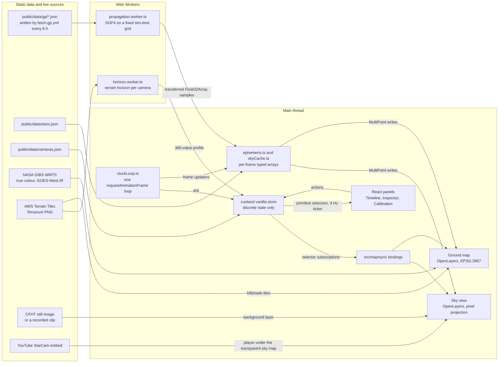

# M9 · Polish and ship

Branch `m9-polish-ship`, one pull request. Contracts: [README.md](README.md). Decisions: [../DECISIONS.md](../DECISIONS.md). Evidence: `verification/satellite-js.md`, `verification/architecture.md`, `verification/openlayers.md`, `verification/sources.md`, `verification/terrain.md`.

"Measured" numbers below were run for this file on 2026-10-11. The machine was an Apple M2 (8 cores, load average 3 to 5). The tools were Playwright 1.64.0 (driven from an arm64 Node; Node only runs the test runner, the numbers are Chromium's) and Chrome for Testing 156.0.8078.4 in new headless mode (`channel: "chromium"`, ANGLE Metal), at DPR 2 and 1440 × 900. The app was a prototype of steps 2 to 4, built with Vite 8.3.4 over the 2026-10-11T03:50:21Z CelesTrak snapshot (11,277 objects). The prototype drew WebGL class points on the ground map, canvas class points in the sky, a pass over 8,404 stars every 2 s of sim time, a canvas tile base layer and the ISS label, and called `renderSync()` on both maps. It had no GIBS imagery, React panels or tracks. Every TypeScript snippet type-checks with tsc 7.0.2 (`strict`, `noUncheckedIndexedAccess`, `moduleResolution: "bundler"`) and passes Biome 2.5.15's recommended rules. Each one was also executed: the culling and BulkPropagator code inside the benchmark worker, the perf spec through `playwright test`, the Lighthouse command as written. The `demo.ts` declaration block in step 10 was type-checked only (against README section 4 and 6 types), and the Mermaid diagram was rendered. Steps 10 and 14 were revised the same day for Parth's decisions O1, O2, O4 and H1 (GitHub Pages at `https://parthjain.ca/Overhead/`). They were checked with Node 26.11.1 arm64, ffmpeg 7.1 (static, arm64), headless Chromium 156.0.8078.4 and WebKit 2370 (Playwright 1.64.0) on the real clip `recordings/subaru-2026-10-11-iss.mp4` (sha256 `cf952b8d…ceaa74e2`), and against live GitHub Pages sites with `curl`. Each step says what was run. A second, independent run on the same machine (load average 2 to 3) rebuilt the benchmark from these exact snippets and repeated steps 2, 4 and 6. Where its numbers differed, the ranges below include both runs.

## 1. Goal

Make the app hold 60 fps with Starlink loaded, prove it with Chrome traces, and finish it as a portfolio piece. That covers:

- a captioned `?demo=1` tour that opens on the recorded 2026-10-11 ISS clip, with the light overlay on the video and the dense data on the ground map, then switches to the live Subaru StarCam with the overlay drawn on the YouTube player;
- shipping that clip, and the element sets from near its pass, with the production deploy (step 14);
- shareable links and the full keyboard map;
- an accessibility pass (Lighthouse ≥ 90);
- the visual design settled from screenshots;
- the final root README and a production deploy to `https://parthjain.ca/Overhead/` (H1).

Out of scope:

- New features or data sources: the tracking-mount stretch goal, OGC API Features, Meteosat.
- Changing a budget in [section 9](README.md#9-performance-budgets). It already holds M9's gates.
- Committing a recording. `recordings/` stays gitignored (O2), and the deploy copy is a release asset fetched at build time (step 14).
- Analytics, a backend, a domain of its own (the site lives under `parthjain.ca`, H1), or any dependency over about 50 kB gzipped.

The visual design (layout, colours, panel placement, styling) is not specified here. It is settled during the build from screenshots (step 12).

## 2. Prerequisites

1. M0 to M8 merged and deployed. M9 uses these parts of earlier milestones:
   - from M3: `ephemeris.ts`, `SampleClient`, `writeClassPoints`, test hooks and `propagation.perf.ts`;
   - from M2: `sky.perf.ts`;
   - from M5: `findPasses` (`passes.ts`), `loadClipFromSidecarUrl`, `clipCamera`, the `subaru-2026-10-11-iss` and `subaru-starcam` cameras, the sky stage (player under the sky map, hit targets, `fs: 0`), the YouTube stub, the test-pattern clip and its sidecar, and the `**/recordings/**` e2e route;
   - from M8: `IncomingChip` and `selectIncomingActive`.
2. Data:
   - Tests use `tests/fixtures/gp/*` (fetched 2026-10-11T03:50:21Z), `iss-pass-maunakea.json` and M5's test-pattern clip.
   - Step 14 needs the recorded clip on the machine that makes the deploy copy: `recordings/subaru-2026-10-11-iss.mp4` (148,643,811 bytes, sha256 `cf952b8d5b2ade856b33d953b2da0b71f2b0b2716d97db1225f95386ceaa74e2`) and its sidecar `recordings/subaru-2026-10-11-iss.json` (README section 8, "Recorded clips"). Step 14f ships the committed `tests/fixtures/gp/` with it.
3. Accounts and tools:
   - the Deploy workflow (`.github/workflows/deploy.yml`), GitHub Pages and the branch protection from M0 step 15;
   - the public repository `FalconXYX/Overhead` (H1) for the release that holds the deploy copy (step 14b), and `gh` or the GitHub web UI to create it (the `gh release create` usage in step 14b was checked against gh 2.83.1);
   - ffmpeg with libx264 for step 14a (a static ffmpeg 7.1 arm64 build was used).
4. A native arm64 laptop for `npm run perf`, with `npx playwright install chromium`. Without `--only-shell` that command installs both Chrome for Testing (`chromium-1248`) and the headless shell (checked in `playwright-core`'s registry); perf needs the former (gotcha 1). Run it from the arm64 Node 26 (O4; `node -p process.arch` prints `arm64`), so Playwright starts the arm64 browser ([M3](M3-satellites.md) gotcha 20).
5. Decisions ([DECISIONS](../DECISIONS.md)):
   - O1 (decided): the sky map is drawn on the YouTube player with the light overlay set; the ground map carries the dense data. The tour shows both (step 10).
   - O2 (decided): clips are recorded from the StarCam streams and kept in `recordings/`. The tour opens on the 2026-10-11 clip, and step 14 ships a copy with the deploy.
   - O4 (decided): Node 26.
   - H1 (decided): GitHub Pages from Actions at `https://parthjain.ca/Overhead/`, `base: "/Overhead/"`, production from `main` only. Step 14 is built on its limits and behaviour (M0 step 15).
   - O3 (open): `ui.demo.paused` and `setDemoPaused` are part of the assumed shape ([README section 4](README.md#store)). If O3 changes: keep `paused` as a module variable in `demo.ts`, with a `subscribe` function that `DemoCaptions.tsx` reads through `useSyncExternalStore`.

## 3. Deliverables

| Path | Change |
| ---- | ------ |
| `src/domain/orbits/cull.ts`, `index.ts` | New: Starlink culling (step 2) |
| `src/domain/orbits/visibility.ts` | `SKY_CUTOFF_GEOMETRIC_DEG`, `belowSkyCutoff` (step 4) |
| `src/workers/propagation.worker.ts` | Starlink samples through `writeCulledSample` |
| `src/workers/bulk.ts` | New, only if step 3's measurement says so: BulkPropagator fallback |
| `src/state/ephemeris.ts` | Sky cut-off and interleaved Starlink ground updates (step 4); element sets follow the active clip (step 14f) |
| `src/state/actions.ts` | `startDemo`, `setDemoStep`, `stopDemo`, `setDemoPaused` (the `ui.demo` shape is M0's) |
| `src/app/demo.ts` | New: tour steps on the clip and the computed sky, the live step, anchor time, runner (step 10) |
| `src/app/clip.ts` | Range probe in `loadClipFromSidecarUrl`: a clip whose server ignores `Range` is read into a Blob (step 14d); `clipGpBaseUrl` (step 14f) |
| `scripts/fetch-deploy-clips.ts` | New: copies the deploy clip from its release asset into `dist/recordings/`, and the clip's element sets into `dist/recordings/<clip>.gp/` (steps 14c, 14f) |
| `src/app/url.ts` | `demo` in `UrlState`, `shareUrl` (step 8) |
| `src/app/keyboard.ts` | Esc order with the tour (step 9) |
| `src/app/testHooks.ts` | `commits()` (step 5) |
| `src/main.tsx` | `<Profiler>`, lazy `import("./app/demo")` |
| `src/ui/DemoCaptions.tsx` | New: tour region (step 10) |
| `src/ui/KeyboardShortcuts.tsx` | New: on-screen key list (step 9) |
| `src/ui/Timeline.tsx` | "Copy link" (step 8) |
| `src/**/*.css` | Visual design pass (step 12), OpenLayers control size (step 11) |
| `vite.config.ts` | `build.chunkSizeWarningLimit` (step 7) |
| `package.json`, `.gitignore` | `build:dev` and `build:pages` scripts (steps 1, 14c); ignore `dist-dev/` and `lighthouse/` (step 11) |
| `.github/workflows/deploy.yml` | The build step runs `npm run build:pages` (step 14c) |
| GitHub release `clips-2026-10-11` | The deploy copy of the clip and its sidecar, never committed (step 14b) |
| `playwright.config.ts` | Perf project on Chrome for Testing with the GPU; `PERF_OUTDIR` (step 1) |
| `tests/perf/starlink.perf.ts`, `commits.perf.ts`, `screens.perf.ts` | New (steps 1, 5, 12) |
| `tests/perf/propagation.perf.ts` | Starlink rows gated at p95 ≤ 10 ms |
| `tests/unit/cull.test.ts`, `demo.test.ts`, `fetchDeployClips.test.ts`, `readme.test.ts` | New (section 5) |
| `tests/unit/visibility.test.ts`, `url.test.ts`, `keyboard.test.ts`, `store.test.ts`, `actions.test.ts`, `clip.test.ts` | Extended (section 5) |
| `tests/e2e/demo.spec.ts`, `share.spec.ts`, `a11y.spec.ts`, `keyboard.spec.ts` | New (section 5) |
| `README.md` | Final: diagram, talking points, performance, keys, credits (step 13) |
| `docs/DECISIONS.md` | Section 8 |

## 4. Steps

Build in this order. Units follow [Units](README.md#units).

### Step 1. Measurement harness first

1. `package.json`: add `"build:dev": "NODE_ENV=development vite build --mode development --outDir dist-dev"`. Add `dist-dev/` and `lighthouse/` (step 11 writes its reports there) to `.gitignore`.
2. `playwright.config.ts` (M0's file), two changes, both type-checked and run:
   - When `PERF=1`, the project's `use` is `{ ...devices["Desktop Chrome"], channel: "chromium", headless: true, viewport: { width: 1440, height: 900 }, deviceScaleFactor: 2 }`. Set `workers: 1` and `timeout: 180_000`. `channel: "chromium"` runs Chrome for Testing in new headless mode on the GPU; the default headless shell renders WebGL on SwiftShader (gotcha 1).
   - Set `webServer.command` to `` `npx vite preview --port 4173 --strictPort --outDir ${process.env.PERF_OUTDIR ?? "dist"}` ``. `PERF_OUTDIR=dist-dev` serves the development build (step 5). `reuseExistingServer` stays `!ci`, so stop any running `npm run preview` first: a reused server keeps serving `dist`, and `commits.perf.ts` then counts 0.
   - Leave the e2e project unchanged.
3. Write `tests/perf/starlink.perf.ts`. It loads the app, checks the GPU, applies CPU throttling through CDP, records a 10 s trace and collects the `overhead:frame` and `overhead:propagate` measures. Replace the "App-specific setup" comment with these steps, in this order:
   1. press `l`, then check the "Starlink" checkbox (M3's label "Starlink (about 11,100; loads 4.7 MB)");
   2. wait until its status matches `/objects, elements fetched/` (M3's group status; "11,102 objects, elements fetched 2026-10-11 03:50 UTC" with the shared fixture's GP route);
   3. move focus to `body` with `page.evaluate(() => (document.activeElement as HTMLElement | null)?.blur())`. `keyboard.ts` ignores keys whose target is an `input`, so `l` pressed on the focused checkbox does nothing;
   4. press `l` to close the panel;
   5. press `]` twice for 60×, then Space.

```ts
// tests/perf/starlink.perf.ts: npm run build && npm run perf -- starlink
import { mkdirSync, writeFileSync } from "node:fs";
import { expect, test } from "../e2e/fixtures";

declare global {
  interface Window {
    __perf?: { frame: number[]; propagate: number[]; since: number };
  }
}

const p95 = (xs: readonly number[]): number =>
  [...xs].sort((a, b) => a - b)[Math.floor(0.95 * xs.length)] ?? Number.NaN;

for (const throttle of [1, 4] as const) {
  test(`Starlink loaded, 60x, CPU ${throttle}x`, async ({ browser, context, page }) => {
    await page.addInitScript(() => {
      const perf = { frame: [] as number[], propagate: [] as number[], since: 0 };
      window.__perf = perf;
      new PerformanceObserver((list) => {
        for (const e of list.getEntriesByName("overhead:frame")) perf.frame.push(e.duration);
        for (const e of list.getEntriesByName("overhead:propagate"))
          perf.propagate.push(e.duration);
      }).observe({ type: "measure" });
    });
    await page.goto("./?cam=synthetic-maunakea&t=2026-10-11T15:09:50Z");
    const gpu = await page.evaluate(() => {
      const gl = document.createElement("canvas").getContext("webgl2");
      const ext = gl?.getExtension("WEBGL_debug_renderer_info");
      return gl && ext ? String(gl.getParameter(ext.UNMASKED_RENDERER_WEBGL)) : "none";
    });
    expect(gpu, "perf needs a GPU-backed WebGL context").not.toMatch(/SwiftShader|none/);
    // App-specific setup, e.g. turn Starlink on, wait for "ready", press ] twice (60x) and Space.
    const cdp = await context.newCDPSession(page);
    await cdp.send("Emulation.setCPUThrottlingRate", { rate: throttle }); // main thread only; workers run at full speed
    await page.evaluate(() => {
      window.__perf?.frame.splice(0); // empty in place: the observer holds this object
      window.__perf?.propagate.splice(0);
      if (window.__perf) window.__perf.since = performance.now();
    });
    mkdirSync("test-results/perf", { recursive: true });
    await browser.startTracing(page, {
      path: `test-results/perf/trace-${throttle}x.json`,
      screenshots: false,
    });
    await page.waitForTimeout(10_000);
    // Read before stopTracing(): writing the trace stalls the page.
    const perf = await page.evaluate(() => {
      const p = window.__perf ?? { frame: [], propagate: [], since: 0 };
      return {
        frame: [...p.frame],
        propagate: [...p.propagate],
        seconds: (performance.now() - p.since) / 1000,
      };
    });
    await browser.stopTracing();
    await cdp.send("Emulation.setCPUThrottlingRate", { rate: 1 });
    const result = {
      throttle,
      fps: perf.frame.length / perf.seconds,
      frameP95Ms: p95(perf.frame),
      frameMaxMs: Math.max(...perf.frame),
      propagateP95Ms: p95(perf.propagate),
    };
    writeFileSync(`test-results/perf/starlink-${throttle}x.json`, JSON.stringify(result, null, 2));
    expect(result.fps).toBeGreaterThanOrEqual(throttle === 1 ? 59 : 55);
    expect(result.frameP95Ms).toBeLessThanOrEqual(throttle === 1 ? 6 : 16);
    if (throttle === 1) expect(result.propagateP95Ms).toBeLessThanOrEqual(10);
  });
}
```

4. No earlier milestone emits `overhead:frame`. Give `clockLoop.ts` the [section 9](README.md#9-performance-budgets) measure: `performance.measure("overhead:frame", { start: t0 })` around each frame callback, then `performance.clearMeasures("overhead:frame")`. A `PerformanceObserver` still receives cleared entries. The measured trace held 599 `overhead:frame` begin/end pairs and 600 `DrawFrame` events in 10 s.
5. Run it on `main` before any change and keep the output as the baseline for the pull request. The M3 path measured p95 5.0–5.8 ms per frame unthrottled (59.3–60.0 fps). At 4× CPU it measured 18.3–20.7 ms per frame and 47.1–55.9 fps, so the 4× gate fails until step 4.

### Step 2. Starlink culling in the worker (`src/domain/orbits/cull.ts`)

M3 recorded Starlink samples at p95 17.8–18.0 ms paced at 10 Hz, over the 10 ms budget. This run measured p95 5.8–8.5 ms for the same plain loop, so the result swings with machine load. Following [DECISIONS](../DECISIONS.md#satellites) ("first cull Starlink"), M9 always culls Starlink. Stations and visual are always propagated in full.

Rule:

1. Each sample propagates every non-Starlink object.
2. It also propagates one tenth of Starlink: the slice with index i where i mod 10 = k mod 10.
3. It also propagates every Starlink "candidate".
4. Every other Starlink row is its held row, moved along its held Earth-fixed velocity.
5. A Starlink object is a candidate when its slant range at its last slice was ≤ `cullLimitKm(stepMs)`. That bound is the range at −10° elevation to a 600 km orbit, plus the farthest it can move in 12 samples. So no object outside the set can rise above −10° before its slice comes round again. It holds at every registry site: the range at −10° to the highest Starlink apogee (576.8 km) is 4,090 km from Maunakea and 4,114 km from Walenstadt (WGS-84 site radius).

Write `cull.test.ts` first (section 5), then this file:

```ts
// src/domain/orbits/cull.ts: Starlink culling for the 10 Hz sample.
import type { SatRec } from "satellite.js";
import { type PropagationContext, SAMPLE_STRIDE, writeSample } from "./sample";

export const CULL_SLICES = 10;
/** Slant range at −10° elevation from 4,204 m to a 600 km orbit is 4,136–4,144 km (by Earth radius); the highest Starlink apogee is 576.8 km. */
export const CULL_RANGE_KM = 4150;
/** Upper bound on a Starlink's Earth-fixed speed (7.902–7.910 km/s measured over 24 h of the snapshot). */
export const CULL_SPEED_KM_S = 8.0;

/** Range beyond which a Starlink cannot climb above −10° before its slice comes round again (window = 12 samples). */
export function cullLimitKm(stepMs: number): number {
  return CULL_RANGE_KM + (CULL_SPEED_KM_S * (CULL_SLICES + 2) * stepMs) / 1000;
}

export interface CullState {
  readonly held: Float32Array; // last slice row per object (position, Earth-fixed velocity, flags)
  readonly heldTimeMs: Float64Array; // sim time of each slice's last refresh
  readonly candidate: Uint8Array; // 1 = propagate every sample
  lastGeneration: number;
  lastK: number;
}
export function createCullState(count: number): CullState {
  return {
    held: new Float32Array(count * SAMPLE_STRIDE),
    heldTimeMs: new Float64Array(CULL_SLICES),
    candidate: new Uint8Array(count),
    lastGeneration: -1,
    lastK: -1,
  };
}

/**
 * Writes sample k like a full pass, except that a culled object (cull[i] = 1) is propagated only on its slice
 * (i mod 10 = k mod 10) or while it is a candidate. Other culled rows are the held row moved along its held
 * velocity. A new generation, or a k that does not follow the last one, forces a full pass.
 * Returns the number of objects propagated.
 */
export function writeCulledSample(
  state: CullState,
  satrecs: readonly SatRec[],
  skip: Uint8Array,
  cull: Uint8Array,
  ctx: PropagationContext,
  out: Float32Array,
  k: number,
  stepMs: number,
  generation: number,
): number {
  const { held, heldTimeMs, candidate } = state;
  const fullPass = generation !== state.lastGeneration || k !== state.lastK + 1;
  state.lastGeneration = generation;
  state.lastK = k;
  const limitKm = cullLimitKm(stepMs);
  const slice = k % CULL_SLICES;
  if (fullPass) heldTimeMs.fill(ctx.timeMs);
  else heldTimeMs[slice] = ctx.timeMs;
  const n = Math.min(satrecs.length, out.length / SAMPLE_STRIDE);
  let computed = 0;
  for (let i = 0; i < n; i++) {
    const o = i * SAMPLE_STRIDE;
    const rec = satrecs[i];
    if (rec === undefined || skip[i] === 1) {
      out.fill(0, o, o + SAMPLE_STRIDE);
    } else if (cull[i] !== 1) {
      writeSample(rec, ctx, out, i);
      computed++;
    } else if (fullPass || i % CULL_SLICES === slice) {
      writeSample(rec, ctx, out, i);
      computed++;
      for (let q = 0; q < SAMPLE_STRIDE; q++) held[o + q] = out[o + q] ?? 0;
      const rangeKm = Math.hypot(out[o] ?? 0, out[o + 1] ?? 0, out[o + 2] ?? 0);
      candidate[i] = out[o + 7] === 1 && rangeKm <= limitKm ? 1 : 0;
    } else if (candidate[i] === 1) {
      writeSample(rec, ctx, out, i);
      computed++;
    } else {
      const dtSec = (ctx.timeMs - (heldTimeMs[i % CULL_SLICES] ?? ctx.timeMs)) / 1000;
      for (let q = 0; q < 3; q++) out[o + q] = (held[o + q] ?? 0) + (held[o + 3 + q] ?? 0) * dtSec;
      for (let q = 3; q < SAMPLE_STRIDE; q++) out[o + q] = held[o + q] ?? 0;
    }
  }
  return computed;
}
```

Wire it into the worker:

1. The worker keeps one `CullState`, created on every `groupLoaded`.
2. It keeps a `cull` mask with 1 for every satrec in the `starlink` group.
3. It keeps a `skip` mask with 1 for docked objects and for objects whose group bit is not in `msg.groups`. Rebuild both masks on every `groupLoaded`, and `skip` again whenever `msg.groups` changes. M3's `SampleClient` flushes on a mask change, so the next sample is a full pass.
4. In `sample` it calls `writeCulledSample(state, satrecs, skip, cull, ctx, out, msg.k, msg.stepMs, msg.generation)` in place of M3's loop.
5. `computeMs` keeps timing the whole call.

The worker needs no protocol change: a flush already bumps `generation`, and that forces a full pass.

Measured, 300 samples per run:

| Rate | Objects propagated per sample (p50) | `computeMs` p50 / p95 / max |
| ---- | -----------------------------------: | --------------------------- |
| 1× | 2,236 | 1.9–2.1 / 2.1–2.6 / 2.1–2.9 ms |
| 60× | 2,562 | 1.9–2.3 / 2.1–2.5 / 2.3–3.6 ms |
| 600× | 6,820–6,821 (the bound grows with D) | 3.8–4.6 / 4.1–5.1 / 5.2–5.4 ms |
| plain loop, 60×, all 11,267 | 11,267 | 5.5–7.6 / 5.8–8.5 / 6.7–9.3 ms |

The check compared every object above −5° against a full pass each sample. It found 0 differences in 59,193 checks at 60× and 61,703 at 600× in the browser, and 0 in 173,116, 174,417 and 196,217 checks at 1×, 60× and 600× in the second run. In Node it found 0 in about 17,000 checks at each of stepMs 100, 1,000, 6,000 and 60,000. A forced full pass costs 11,267 propagations, the plain-loop cost of 6–9 ms, once after each flush.

### Step 3. BulkPropagator: measure, do not ship by default

[DECISIONS](../DECISIONS.md#satellites) says to try `BulkPropagator` if culling is not enough. Measured on the full Starlink set it was barely faster than the plain loop, as DECISIONS records: p50 5.2–6.5 ms against 5.5–7.6 ms, and p95 5.9–7.5 against 5.8–8.5 ms (second run, same session: 5.9 / 6.4 ms against 6.6 / 7.1 ms, about 10%). Setup took 99–115 ms. Culling is 2.5 to 3 times cheaper. Ship `bulk.ts` only if `propagation.perf.ts` shows culled p95 > 10 ms on a target laptop and a bulk run beats it there. Record the outcome in DECISIONS either way.

The verified call shape follows. Its rows matched `writeSample` for every object above −5° at 60× and 600×: position within 1e-3 km, velocity within 1e-6 km/s, sunlit flags equal. Run in Node at three times, all 11,102 Starlink rows were bit-identical to `writeSample`'s Float32 rows, and `run()` returned `undefined`.

```ts
// BulkPropagator fallback for Starlink, same row layout as writeSample.
import {
  BulkPropagator,
  createSingleThreadRuntime,
  EciBaseCalculator,
  type SatRec,
  ShadowFractionCalculator,
  SunPositionCalculator,
} from "satellite.js";
import { EARTH_ROTATION_RAD_S } from "../domain/geo";
import { type PropagationContext, SAMPLE_STRIDE } from "../domain/orbits";

/** Once per group load. Never createMultiThreadRuntime: it needs COOP/COEP. */
export async function createStarlinkBulk(recs: SatRec[]) {
  const runtime = await createSingleThreadRuntime();
  const bulk = new BulkPropagator({
    runtime,
    calculators: [
      new EciBaseCalculator(),
      new SunPositionCalculator(),
      new ShadowFractionCalculator(),
    ],
    satRecsCount: recs.length,
    datesCount: 1,
  });
  bulk.setSatRecs(recs);
  return bulk; // bulk.dispose() when the group or the worker goes away
}
export type StarlinkBulk = Awaited<ReturnType<typeof createStarlinkBulk>>;

/** Row j of the bulk output goes to object rows[j] of `out`. */
export function writeBulkSample(
  bulk: StarlinkBulk,
  rows: Int32Array,
  ctx: PropagationContext,
  out: Float32Array,
): void {
  bulk.setDates([ctx.date]);
  bulk.run(); // single-thread runtime: synchronous
  const { eci, shadowFraction } = bulk.getRawOutput(); // views on WASM memory: read now, never keep or post
  const c = Math.cos(ctx.gmstRad);
  const s = Math.sin(ctx.gmstRad);
  const m = ctx.enuToEcef;
  const ob = ctx.observerEcefKm;
  for (let j = 0; j < rows.length; j++) {
    const o = (rows[j] ?? 0) * SAMPLE_STRIDE;
    if (eci.error[j] !== 0) {
      out.fill(0, o, o + SAMPLE_STRIDE);
      continue;
    }
    const px = eci.position[3 * j] ?? 0;
    const py = eci.position[3 * j + 1] ?? 0;
    const pz = eci.position[3 * j + 2] ?? 0;
    const qx = eci.velocity[3 * j] ?? 0;
    const qy = eci.velocity[3 * j + 1] ?? 0;
    const rx = px * c + py * s; // TEME -> ECEF by GMST, as eciToEcf
    const ry = -px * s + py * c;
    const vx = qx * c + qy * s + EARTH_ROTATION_RAD_S * ry; // Earth-fixed velocity: also subtract ω × r
    const vy = -qx * s + qy * c - EARTH_ROTATION_RAD_S * rx;
    const vz = eci.velocity[3 * j + 2] ?? 0;
    const dx = rx - (ob[0] ?? 0);
    const dy = ry - (ob[1] ?? 0);
    const dz = pz - (ob[2] ?? 0);
    for (let a = 0; a < 3; a++) {
      const m0 = m[a] ?? 0;
      const m1 = m[3 + a] ?? 0;
      const m2 = m[6 + a] ?? 0;
      out[o + a] = m0 * dx + m1 * dy + m2 * dz; // ENU = Mᵀ (r − O)
      out[o + 3 + a] = m0 * vx + m1 * vy + m2 * vz;
    }
    out[o + 6] = (shadowFraction[j] ?? 1) < 0.5 ? 1 : 0;
    out[o + 7] = 1;
  }
}
```

### Step 4. Main-thread frame pass (`src/state/ephemeris.ts`)

M3's `updateEphemerisFrame` does the full chain for every object on every frame: interpolate, ECEF, Bowring, EPSG:3857, az/alt and refraction. Add two rules. Neither applies to the selected or the hovered object, nor to stations or visual objects.

1. Sky cut-off. Add `SKY_CUTOFF_GEOMETRIC_DEG = -3` and `belowSkyCutoff(eKm, nKm, uKm)` to `visibility.ts`. The function is `u < 0 && u² > sin²(3°)·(e² + n² + u²)`: no trigonometry and no square root.
   - A Starlink row that is below the cut-off skips `enuToAzAltDeg`, `apparentAltDeg` and projection. Clear its above-horizon and visible flags and leave `azAltDeg` as it was.
   - Why −3°: `apparentAltDeg(−3)` is −2.368°, below the lowest horizon in the registry (the −1.94° sea horizon from 4,204 m). A −2° cut-off would give −1.361° and hide objects that can be drawn.
2. Interleaved ground updates. On frames where `(i & 1) !== (frameCount() & 1)`, a Starlink row keeps its `lonLatDeg`, `mercator` and sunlit flag from the frame before. Each Starlink then updates on the ground at 30 Hz.
   - Interleave only while `clock.playing` is true and `SampleClient.generation` is the same as on the previous frame. Any other frame that runs the loop (a seek, step or scrub while paused, a flush) updates every row. Otherwise a scrub while paused leaves half the Starlink dots at the old time.
   - The first frame after playing stops runs the loop once in full, even though M3's "nothing changed, skip the loop" check would skip it. Otherwise a paused view keeps half the dots one frame behind: at 600× one frame is 10 s of sim time, about 75 km.
   - On an interleaved frame, if the row is below the cut-off in both samples a and b, skip it entirely. The cone of rows below −3° is convex, so linear interpolation (up to 60×) between two points inside it stays inside it. Hermite at 600× can overshoot slightly, but the cut-off sits 0.43° below the lowest drawable horizon, and the row is fully recomputed on the next frame.
   - Rebuild the class flat arrays every frame from the per-index arrays.
3. Keep M3's write path: one `MultiPoint` per group and class, written in place with one `changed()` per geometry (`verification/architecture.md` claims 2–3). M3 creates each class `VectorSource` empty and lets `writeClassPoints` add the feature, which is safe. Never pass the array the layer code indexes as `features` to a `VectorSource`. If a source must start with features, pass a copy (`features: [...classes]`) (gotcha 4).

Measured `overhead:frame` with Starlink at 60×, in ms:

| Path | CPU 1×: p50 / p95 / max, fps | CPU 4×: p50 / p95 / max, fps |
| ---- | ---------------------------- | ---------------------------- |
| M3 path | 4.8 / 5.8 / 6.6, 60.0 | 15.7 / 18.4 / 25.8, 55.0 (101 frames > 20 ms) |
| + sky cut-off | 4.2 / 5.4 / 5.7, 60.0 | 14.0 / 16.9 / 23.2, 59.2 (16 frames > 20 ms) |
| + interleave | 3.6 / 4.6 / 5.2, 60.0 | 9.4 / 11.8 / 14.7, 60.0 (0 frames > 20 ms) |

The second run reproduced every row within 0.5 ms on p50 and p95, for example M3 path at 4× 15.5 / 18.4 / 24.1 ms at 55.3 fps, and both rules at 4× 9.4 / 11.8 / 13.3 ms at 60.0 fps. At 600× with both rules the frame measured 4.1 / 4.6 / 4.8 ms unthrottled and 11.5 / 12.5–13.0 / 15.0–20.9 ms at 4×, both at 60.0 fps. Rendering both maps (`renderSync`) took a p95 of 1.0–1.2 ms unthrottled. The sky view stays a canvas layer: about 340–450 Starlinks were above the horizon (`verification/architecture.md` claim 30).

### Step 5. React commit audit

1. `main.tsx` wraps `<App />` in `<Profiler id="overhead" onRender={recordCommit}>`. `recordCommit` increments a module counter.
2. `OverheadTestHooks` gains `commits(): number`. The Profiler is inert in production builds, so production cost is nil.
3. Find extra commits: anything that re-renders while playing with no input, other than `useTick4Hz` subscribers. Fix each one per [React rules](README.md#react-rules).
4. Write `tests/perf/commits.perf.ts` (section 5).

Measured with React 19.3.0, `StrictMode` and two `useTick4Hz` components, over 10 s:

| Build | Commits per second |
| ----- | ------------------ |
| `vite build` | 0 |
| `vite build --mode development` | 0 |
| `NODE_ENV=development vite build --mode development` | 4.0 |
| Vite dev server | 4.0 |

### Step 6. Traces for the pull request

1. Run `npm run build && npm run perf -- starlink`.
2. Gzip `test-results/perf/trace-1x.json` and `trace-4x.json` (`gzip -9`) and attach both, with the two result JSON files and the line naming the machine, the browser and `UNMASKED_RENDERER_WEBGL`.
3. Sizes measured for 10 s: about 50 MB raw and 3.4 MB gzipped without screenshots; 69–80 MB raw and 23.7 MB gzipped with them. GitHub takes files up to 25 MB, including `.json` and `.gz`, and videos up to 10 MB on a free plan. Keep `screenshots: false`, and show motion in a separate clip.
4. A reviewer loads the trace in DevTools → Performance → Load profile, after `gunzip`. In the 4× trace, check the `overhead:frame` user timings, `DrawFrame` close to 600 per 10 s, and no main-thread task over 50 ms except one known artifact (gotcha 18). Name that task in the pull request.

The measured spec runs passed both cases:

| CPU | fps | frame p95 | frame max | propagate p95 |
| --- | --- | --------- | --------- | ------------- |
| 1× | 59.9–60.0 | 3.5 ms | 5.6–6.8 ms | 1.8–1.9 ms |
| 4× | 59.1–59.3 | 14.4–14.9 ms | 23.0–26.1 ms | 2.3–2.4 ms |

The second run's traces were 52.9 MB and 42.1 MB raw, and 3.4 MB and 3.2 MB gzipped, with 600 and 593 `DrawFrame` events.

### Step 7. Bundle

1. `?demo=1` loads `src/app/demo.ts` through `import("./app/demo")`. That module imports satellite.js for `findPasses`. Measured as a separate chunk of 23.2 kB (11.3 kB gzipped), with no WASM chunk.
2. A first-load bundle with React, zustand, astronomy-engine and the OpenLayers modules the app uses measured 715 kB minified (211 kB gzipped). Vite warns above 500 kB.
   - Splitting out ajv saves only 35 kB gzipped and would mean importing `geopose.ts` around the domain index ([import rule 3](README.md#3-file-layout)).
   - So, after measuring the real build, set `build.chunkSizeWarningLimit` just above the entry chunk and record the size in DECISIONS.

### Step 8. Shareable URL state

1. `UrlState` gains `demo: boolean`, true only for `?demo=1`. `writeUrlState` appends `&demo=1` while `ui.demo.active`. `startUrlSync` also watches `ui.demo.active`, so exiting the tour removes the parameter.
2. Add `shareUrl(state, href): string`. It returns `new URL(search, href).href`, where `search` is `writeUrlState(state)` without the `demo` parameter.
   - In replay it always carries `t` = the current `simTimeMs`, even while playing. The address bar does not: M1 writes `t` only when paused.
   - In live mode it carries no `t`, so the link opens live.
   - It carries `cam` and `sel` when set.
3. Add a "Copy link" button to the Timeline.
   - It calls `navigator.clipboard.writeText(shareUrl(store.getState(), location.href))` inside the click handler.
   - On success, a `role="status"` text reads "Link copied".
   - On rejection, show the URL in a read-only, selected `<input>` labelled "Link to this view".
   - When `navigator.clipboard?.writeText` is undefined, show that input at once. That is the case on `http://parthjain.ca/Overhead/`, which GitHub Pages serves without redirecting to https (M0 step 15): an http page is not a secure context, and headless Chromium 156 had no `navigator.clipboard` there.
4. Invalid parameters keep M1/M3 behaviour: `console.warn`, then the defaults.

### Step 9. Keyboard map

`keyboard.ts` ends with this table. Every key also has an on-screen control. The handler's ignore rules from M1 still apply: inputs, `defaultPrevented`, Alt/Ctrl/Meta, and Space on a button.

| Key | Effect | Notes |
| --- | ------ | ----- |
| Space | `togglePlay()` | |
| ← / → | `stepBy(∓1000)` | Shift: ∓60,000 ms; off while Calibration is open |
| `[` / `]` | previous / next offered rate | 1, 10, 60, 600; 1 and 10 with a clip (M5) |
| L | `togglePanel("layers")` | |
| C | `togglePanel("calibration")` | |
| ← → ↑ ↓ with Calibration open | `azDeg` ∓0.05° (`rollDeg` on a zenith-locked fisheye); `altDeg` ±0.05° | Shift: 0.5° |
| Esc | tour active → `stopDemo()`; else pending point → `cancelImagePoint()`; else `select(null)` | first match only |
| arrows, `+`, `−` on a focused map | pan and zoom | OpenLayers `KeyboardPan` and `KeyboardZoom` defaults |

`KeyboardShortcuts.tsx` renders the same table inside `<details><summary>Keyboard shortcuts</summary>`. It needs no store state and no new key. Its rows come from `KEY_MAP` in `keyboard.ts` ([README section 6](README.md#state-app-and-map-modules)), so the list and the handler cannot drift apart.

### Step 10. Demo mode (`?demo=1`)

The tour opens on the recorded 2026-10-11 ISS clip, camera `subaru-2026-10-11-iss` ([README section 8, "Recorded clips"](README.md#recorded-clips)). The video gets the light overlay ([README section 4, "Sky over video"](README.md#sky-over-video)), and the ground map gets the dense data. The tour ends on the live Subaru StarCam, with the same overlay drawn on the YouTube player. A build without the clip runs the same steps on the computed sky: CI, `npm run preview`, or any build where the clip fails to load.

**The two paths.**

1. **Clip path.** `DemoContext.clip` is `{ startUtcMs }` once the registry's `subaru-2026-10-11-iss` entry has a non-null `source.videoUrl` and `source.startUtcMs`. M5's `loadClipFromSidecarUrl` sets both, with step 14's Range probe. Production serves the clip and its element sets (step 14), so `https://parthjain.ca/Overhead/?demo=1` takes this path.
2. **Computed-sky path.** `DemoContext.clip` is null when the entry is not enabled, when its sidecar answered "This clip is not part of this build", or when the clip failed. The tour then works from `anchorMs` (below).

**Clip timing.** Media 0 is 2026-10-11T15:08:30.183Z (`startUtcMs` 1791731310183). Step 1 seeks to media 60 s (`DEMO_CLIP_SEEK_MS` = 60,000, private to `demo.ts`). That is 18.7 s before the ISS enters at the right edge (media 78.7 s) and inside M8's 60 s look-ahead, so the incoming chip names the ISS before it appears. Playing at 1×, the clip reaches media 105 s at the end of step 1 and 150 s at the end of step 2. It holds 150 s through steps 3 and 4 (paused), then reaches 190 s after step 5 and 225 s after step 6. The ISS is in view throughout, until it goes behind the large dome at media 228.0 s.

**Anchor time (computed-sky path only).** The computed-sky path needs a moment worth showing: an ISS pass in the 48 h before the GP snapshot (`meta.json` `stations.fetchedAtMs`), never measured from `Date.now()` (gotcha 14).

1. Use M5's `findPasses(satrec, site, fromMs, toMs, 10_000, 10)` ([README section 6](README.md#6-module-apis), `passes.ts`). It reports `sunlitAtCulmination` and `sunAltDegAtCulmination`.
2. `chooseDemoPass(passes)`:
   1. Take the passes with `maxAltDeg` ≥ 30.
   2. If any of them has the Sun ≤ 0° at culmination, pick the highest of those; otherwise pick the highest of all of them.
   3. If no pass reaches 30°, take the highest pass ≥ 10°; if there is none, return null.
3. `anchorMs = culminationMs − DEMO_LEAD_MS` (180,000), or `fetchedAtMs − 3,600,000` when the result is null.
4. Measured on the committed snapshot, at Maunakea:
   - five passes ≥ 10° in the window;
   - the chosen pass culminates at 2026-10-10T15:56:58Z at 67.24°, sunlit, with the Sun at −5.1°;
   - so `anchorMs` is 2026-10-10T15:53:58Z;
   - the scan took 97 ms in Node, once per tour.
   - Over the 30 days after the snapshot there were 37 passes ≥ 30°, and the longest gap between them was 38.2 h, so a 48 h window always held one. Only 4 of the 37 were visible to the eye (sunlit with the Sun ≤ −6°), hence the Sun ≤ 0° preference.

The `src/app/demo.ts` types, in declaration form. They type-check with tsc 7.0.2 against README sections 4 and 6, and two `DEMO_STEPS` entries written against them (steps 1 and 8 below) type-check and pass Biome:

```ts
// src/app/demo.ts — public API (declaration form) [M9]
import type { ObserverSite } from "../domain/geo";
import type { Pass } from "../domain/orbits";
import type { AppStore } from "../state/store";

export type DemoStepId =
  | "intro"
  | "clip"
  | "linked"
  | "sensor"
  | "ogc"
  | "imagery"
  | "architecture"
  | "terrain"
  | "live"
  | "end";
export interface DemoContext {
  readonly store: AppStore;
  readonly anchorMs: number; // computed-sky fallback: ISS culmination − 180 s
  readonly clip: { readonly startUtcMs: number } | null; // the recorded clip, once loaded; null when this build lacks it
  readonly nowMs: number;
}
export interface DemoStep {
  readonly id: DemoStepId;
  readonly durationMs: number | null; // null: waits for the user
  caption(ctx: DemoContext): string;
  skip?(ctx: DemoContext): boolean; // true: the runner passes over this step
  enter(ctx: DemoContext): void; // store actions only
}
export const DEMO_STEPS: readonly DemoStep[];
export const DEMO_PASS_WINDOW_MS: 172_800_000;
export const DEMO_LEAD_MS: 180_000;
/** Passes ≥ 30° first; among them prefer Sun ≤ 0° at culmination; then the highest; null when none ≥ 10°. */
export function chooseDemoPass(passes: readonly Pass[]): Pass | null;
/** Fetches gp/stations.json and gp/meta.json, runs findPasses for 25544 over [fetchedAtMs − 48 h, fetchedAtMs]. Never rejects: Date.now() − 1 h on failure. */
export function loadDemoAnchorMs(baseUrl: string, site: ObserverSite): Promise<number>;
/** "" or the 90-day GIBS note for a sim time more than 90 days before nowMs. */
export function goesWindowNote(simTimeMs: number, nowMs: number): string;
/** Subscribes to ui.demo, runs skip, enter and the step timer; returns the stop function. */
export function startDemoRunner(store: AppStore, anchorMs: number): () => void;
```

The exported names are the ones README section 6 lists for `demo.ts`. `DEMO_CLIP_SEEK_MS`, `DEMO_LIVE_WAIT_MS` (15,000), the clip camera id `"subaru-2026-10-11-iss"` and the live camera id `"subaru-starcam"` are private constants of the module.

**Steps.** `DEMO_STEPS` is data, and each `enter(ctx)` calls store actions only. "Clip" and "Computed sky" name the two paths; one entry covers both.

| # | id | Duration | `enter`, clip path | `enter`, computed-sky path |
| - | -- | -------- | ------------------ | -------------------------- |
| 0 | intro | null | If the registry has `subaru-2026-10-11-iss`: `setActiveCamera("subaru-2026-10-11-iss")`. M5 then loads the sidecar and the clip and recentres on media 0, paused. | Same call; the load fails, or the entry is absent and nothing happens |
| 1 | clip | 45 s | `setActiveCamera("subaru-2026-10-11-iss")` unless it is active, `seek(clip.startUtcMs + 60_000)`, `setRate(1)`, `play()` | `setActiveCamera("synthetic-maunakea")`, `recenter(anchorMs)`, `setRate(10)`, `play()` |
| | | | Both paths: `setLayer("satellites", true)`, `setLayer("trails", true)` | |
| 2 | linked | 45 s | `select("sat:25544")` if the ISS's apparent altitude is > 0 now, else the highest drawn sunlit satellite, else no change; `setLayer("footprint", true)`; `setFootprintHeightKm(null)` | Same |
| 3 | sensor | 50 s | `pause()`, `openPanel("calibration")` | Same |
| 4 | ogc | 30 s | `openPanel(null)`; the region shows the active camera's `toGeoPose(...)` JSON and the `validateGeoPose` result | Same |
| 5 | imagery | 40 s | `setLayer("goesIr", true)`, `setRate(1)`, `play()` | `setLayer("goesIr", true)`, `setRate(600)`, `play()` |
| 6 | architecture | 35 s | `setLayer("starlink", true)`, `setRate(1)`, `play()` | `setActiveCamera("synthetic-maunakea")`, `recenter(anchorMs)`, `setRate(60)`, `setLayer("starlink", true)`, `play()` |
| 7 | terrain | 40 s | `setActiveCamera("ask053-walenstadt")` if enabled, else `"synthetic-walenstadt"`; `setLayer("horizon", true)`, `setLayer("hillshade", true)`, `setRate(10)`, `play()` | Same, plus `seek(anchorMs − 10_800_000)` |
| 8 | live | 45 s | `setActiveCamera("subaru-starcam")`, `setMode("live")`. `skip` is true when the registry has no `subaru-starcam` | Same |
| 9 | end | null | none; buttons "Restart tour" (`setDemoStep(0)`) and "Exit tour" (`stopDemo()`) | Same |

Captions, exact text. `caption(ctx)` picks the clip text when `ctx.clip` is not null.

| id | Clip path | Computed-sky path |
| -- | --------- | ----------------- |
| intro | "A guided tour of Overhead: satellites, the ISS, the Moon, planets and bright stars, computed and drawn over a sky camera, with the same moment on a ground map." | Same |
| clip | "The Subaru-Asahi StarCam on Maunakea, recorded on 2026-10-11 at 15:09 UTC. The overlay is computed from public orbital elements and a star catalogue through this camera's lens model; nothing is placed by hand. The ISS enters from the right in about 20 seconds." | "The computed sky over Maunakea at the time of a bright ISS pass. Every label comes from public orbital data; nothing is placed by hand." |
| linked | "Select an object on the video or on the map, and the other view highlights it on the next frame. The video keeps a light overlay; the ground map carries the detail: the ground track, the camera's view at the satellite's height, and the next satellite to enter the frame." | Same |
| sensor | "A lens is a map projection: rectilinear is gnomonic, a fisheye is azimuthal. On this clip, 73 stars fixed the pointing to 0.04°, and the camera's burned-in clock agrees with the ISS to 0.3 s." | "A lens is a map projection: rectilinear is gnomonic, a fisheye is azimuthal. Stars fix the pointing; a fast satellite fixes the clock." |
| ogc | "The camera pose as OGC GeoPose 1.0 Basic-YPR, validated against the official schema." | Same |
| imagery | "GOES-West infrared from NASA GIBS over WMTS. The Time dimension follows the clock in 10-minute steps." plus `goesWindowNote` | Same |
| architecture | "Starlink is on: about 11,100 satellites move on the ground map while the video keeps its light overlay. Two maps, one clock: orbits run in a Web Worker, and React re-renders four times a second." | "Two maps, one clock. Orbits run in a Web Worker; about 11,300 satellites move at 60 fps, and React re-renders four times a second." |
| terrain | "The skyline is computed from elevation tiles: the Churfirsten wall to the north rises about 33°. The hillshade is lit by the Sun at the clock time; at night it uses a fixed light." | Same |
| live | "The live Subaru StarCam, with the same light overlay drawn on the YouTube player. The stream runs about 50 seconds behind real time; the Calibration panel's stream-delay control sets the offset." | Same |
| end | "End of the tour." | Same |

The caption numbers come from the clip's sidecar and README section 8: 73 stars and `rmsDeg` 0.0415 for the pointing, and `startUncertaintyS` 0.3 for the clock. Starlink is 11,102 objects in the fixture snapshot (M3's toggle label says "about 11,100"), and 11,277 objects are loaded in all. The stream delay is `subaru-starcam`'s default `streamDelayMs`, 50,000.

Rules for the runner and the captions:

1. Timed steps total 330 s on either path. The computed-sky path keeps step 2 at 10× because `selectIncomingActive` is false at 60× and 600× (M8). The clip path stays at 1× (M5 offers only 1× and 10× for a clip) and never plays past media 225 s.
   - Why the computed-sky terrain step seeks: step 6 recentres on `anchorMs` and plays 35 s at 60×. Without a seek, step 7 would start at 2026-10-10T16:28:58Z, with the Sun at 1.8° (az 257.9°) at Walenstadt and setting during the step. `anchorMs − 3 h` is 2026-10-10T12:53:58Z, with the Sun at 31.4° (az 210.7°). That lies inside the ± 12 h scrub range step 6 set.
   - The clip path does not seek: step 7 starts at about 15:12:15Z on 2026-10-11, with the Sun at 13.8° (az 243.0°) at Walenstadt, and 12.8° when the step ends at 10×.
2. `DemoContext.clip` is `{ startUtcMs }` when `registry["subaru-2026-10-11-iss"]` is a `local-video` camera with non-null `source.videoUrl` and `source.startUtcMs`; else null. The runner builds it afresh for every step.
3. `goesWindowNote(simTimeMs, nowMs)` returns "" when `nowMs − simTimeMs` ≤ 90 days. Otherwise it returns " GIBS keeps geostationary imagery for 90 days, so this date has none." ([DECISIONS](../DECISIONS.md#gibs-imagery)). For the clip path that note starts to show from 2027-01-09.
4. `enter` never awaits the network. A failed layer shows its usual status, and the tour goes on.
5. `startDemoRunner(store, anchorMs)` subscribes to `ui.demo` and builds each `DemoContext` from the store, `anchorMs`, the clip (rule 2) and `Date.now()`.
   - On each step change it first calls `skip?.(ctx)`. When that returns true, it calls `setDemoStep(step + 1)` without `enter` (Previous moves to `step − 1` instead).
   - Otherwise it calls `enter` once, then starts a `setTimeout` for `durationMs` that calls `setDemoStep(step + 1)`.
   - `setDemoPaused(true)` keeps the remaining time; `false` restarts the timer with it.
   - A step change while paused (Previous or Next) calls `enter` and holds the new step's full `durationMs` until resume.
   - The live step: when `video.status` becomes `embed-blocked` or `error`, or is not `playing` `DEMO_LIVE_WAIT_MS` (15,000 ms) after `enter`, the runner calls `setDemoStep(9)` at once. M5 has then already switched to replay (README section 4, "Sky over video" rule 9).
   - `stopDemo()` clears the timer.
6. `main.tsx`, when `url.demo`: `import("./app/demo")`, then `const anchorMs = await loadDemoAnchorMs(...)`, then `startDemoRunner(store, anchorMs)` and `startDemo()`. `loadDemoAnchorMs` never rejects: on a failed fetch or parse it calls `console.warn` and resolves to `Date.now() − 3,600,000`.
7. `DemoCaptions.tsx` is `<section aria-label="Tour">`. It holds:
   - "Step n of N" on timed steps only, where N counts the timed steps `skip` does not pass over: 8, or 7 without `subaru-starcam`;
   - the caption in an `aria-live="polite"` element;
   - on the intro step, a status line and the button "Start the tour" (`setDemoStep(1)`):
     - while the clip camera is active and `video.status` is `loading`, the line reads "Loading the recorded clip…" and the button is disabled;
     - when `DemoContext.clip` is null and the clip is not loading, the line reads "The recorded clip is not part of this build, so the tour runs on the computed sky.";
     - focus moves once to "Start the tour" when it becomes enabled;
   - the buttons "Previous", "Pause tour", "Next" and "Exit tour". "Pause tour" is a toggle: `aria-pressed="true"` while paused, and its label never changes (a toggle whose label flips confuses screen readers).
8. The Tour region sits outside the sky stage element (README section 4, "Sky over video" rule 4). It never covers the player, so the player's controls and the hit targets keep their clicks. The stage's Fullscreen shows the player and the overlay without the captions.
9. The tour never calls `setVideoLayer`. The video keeps the light set (Starlink, grid and dense labels off), while the ground map shows every layer the steps turn on: tracks, footprint, Starlink, GOES and hillshade.

### Step 11. Accessibility pass

1. Focus ring. Never remove the UA ring without a replacement. Every Tab stop must show an `outline-style` other than `none`, or a `box-shadow` other than `none`.
2. OpenLayers controls. `ol/ol.css` sizes `.ol-control button` at 1.375 em, which is 22 × 22 CSS px, so Lighthouse's `target-size` audit fails on desktop. Add `.ol-viewport .ol-control button { width: 24px; height: 24px; }`. It needs that specificity: `main.tsx` imports `ol/ol.css` first, and a plain `.ol-control button` rule placed before it lost.
3. Reduced motion. With `prefers-reduced-motion: reduce`:
   - trails are off and their toggle reads "(off: reduced motion)" (M3);
   - "Show on map" and Follow jump instead of animating;
   - CSS transitions and animations are off;
   - the tour changes steps without animation.
4. Meaning never rides on colour alone. Lit and shadowed satellites differ in shape (M3). Camera statuses (M4), "behind terrain" (M6), "Imagery as of" (M7) and the incoming chip (M8) are text. Review the step 12 screenshots in grayscale (`html { filter: grayscale(1) }` through `page.addStyleTag`).
5. Landmarks. Keep one `<main>` (M0) and named `<section>` regions. Map containers keep their `aria-label` (M1, M2, M5).
6. Lighthouse 13.5.0, run by hand, not a dependency (it needs Node ≥ 22.19). With `npm run build && npm run preview` running, run this for each URL and preset (executed on the prototype, which was served at the root before the `/Overhead/` base: score 100):

```sh
mkdir -p lighthouse # Lighthouse does not create it: "--output-path ... cannot be written to"
export CHROME_PATH="$(node -p "require('playwright-core').chromium.executablePath()")"
npx --yes lighthouse@13.5.0 "http://localhost:4173/Overhead/?cam=synthetic-maunakea&t=2026-10-11T15:09:50Z" \
  --only-categories=accessibility --preset=desktop \
  --output=json --output=html --output-path=./lighthouse/a11y-default-desktop \
  --chrome-flags="--headless=new" --quiet
```

   - Run three URLs: the one above, the same with `&sel=sat:25544`, and `http://localhost:4173/Overhead/?demo=1`. Keep the `/Overhead/` base: `vite preview` serves nothing else (M0 step 3).
   - Run each URL with `--preset=desktop` and without it (mobile).
   - The score is `categories.accessibility.score × 100` in `<path>.report.json`.
   - Measured on a page with two OpenLayers maps: 84 on desktop and 95 on mobile without a `<main>` and without the 24 px rule; 100 on both with them.
   - Lighthouse cannot open panels, so `a11y.spec.ts` covers panel states.

### Step 12. Visual design pass from screenshots

1. Write `tests/perf/screens.perf.ts`, using the shared fixture so tiles and data are deterministic. It saves `test-results/screens/<viewport>/<state>.png` with `fullPage: true`.
   - Viewports: 1440 × 900, 1280 × 800, 820 × 1180, 390 × 844.
   - States:
     1. default;
     2. `&sel=sat:25544`;
     3. Layers open;
     4. Calibration open on `cfht-nanaao`;
     5. Starlink on;
     6. GOES on at M7's e2e time;
     7. `?demo=1` intro and step 1 (on the routed test-pattern clip);
     8. `subaru-starcam` with the YouTube stub: the sky map over the player, hit targets on;
     9. `subaru-2026-10-11-iss` with the routed test pattern and the light overlay;
     10. an error state (route `data/gp/starlink.json` to 500; Chromium logs the failed load as a console error, so this state removes exactly that error from `guard.consoleErrors` at its end, as M4's e2e test 2 does, [README section 8](README.md#end-to-end-tests) item 4);
     11. reduced motion;
     12. grayscale.
2. Run it with `npm run build && npm run perf -- screens`. Put the set (52 images) in the pull request as one contact sheet per viewport.
3. Parth chooses or comments. Record each choice in DECISIONS under "Visual design" with a one-line reason: layout below 900 px, palette and contrast, panel placement, type scale, marker shapes.
4. Implement the choices with plain CSS or CSS Modules (Vite built in). Use no CSS framework without asking (50 kB rule).
5. Repeat steps 2 to 4 until approved. The last round's set is the evidence.

Constraints that the design must keep:

- credits visible at all times;
- over the YouTube player, only the hit targets take pointer events, so the player's own controls stay usable ([README section 4](README.md#sky-over-video), "Sky over video" rules 5 and 6);
- the overlay keeps tracking the video's content box through resizes, letterboxing and the stage's Fullscreen (rules 7 and 8);
- a visible focus ring;
- targets of at least 24 × 24 CSS px;
- Lighthouse contrast passing;
- differences in shape, not only in colour.

### Step 13. Root README

Final `README.md`, in this order:

1. One paragraph from the brief's summary, then the production URL and one screenshot, `docs/overview.png`: the tour's step 1 on the recorded clip, with the overlay on the ISS. Recordings themselves never go in the repository (O2).
2. "Try it": example links for `?cam` (including `?cam=subaru-2026-10-11-iss`, the recorded clip, and `?cam=subaru-starcam`, the live overlay), `?t`, `?sel` and `?demo=1`.
3. Architecture: this diagram (renders in Mermaid 10.9.3, 11.4.1 and 12.1.0: 16 nodes, 19 edges), then five bullets: one clock, two imperative maps, workers own the math, high-rate data stays out of the store, and React renders at 4 Hz.



4. Talking points, one or two lines each, each with the test or number that backs it:
   - A camera is a map projection: rectilinear is gnomonic, fisheyes are azimuthal. The closed forms match proj4 to < 1e-9.
   - Same math as ISR video annotation.
   - Space domain awareness: a ground sensor checked against the catalogue.
   - Two-step calibration: stars move 15.04°/h and fix pointing; the ISS crosses about 0.99°/s at a 76.9° pass and fixes time (`verification/architecture.md` claim 21).
   - Performance by design: the step 2, 4 and 5 numbers.
   - OGC standards: WMTS with a Time dimension, and GeoPose 1.0 validated against the vendored schema.
   - Sky over video: the sky map is drawn on the YouTube player and on the recorded clip, light by design (the ISS and the other stations and visual satellites, a few bright stars, the Moon and planets); the ground map carries the dense data. The player keeps its controls through `pointer-events: none` and `ol/Overlay` hit targets.
   - Measured on the recorded pass: with a star fit (73 stars, 0.029° rms) and the burned-in clock, the ISS marker sits 1.2 px rms from the ISS on the 1920 × 1080 frame when the element set is 20 h old (the clip sidecar's `timingSource`; README section 8, "Recorded clips").
   - Engineering constraints: the site is static on GitHub Pages under `/Overhead/`, so the recorded clip ships as a 22.4 MiB copy with the element sets from near its pass (step 14); a clip served without byte ranges is read into a Blob so it can seek; the YouTube stream runs about 50 s behind real time; GIBS keeps GOES imagery for 90 days.
5. Performance: the tables from steps 2, 4 and 6 with machine and browser, and how to reproduce them (`npm run perf`).
6. Keyboard shortcuts: the step 9 table.
7. Accessibility: what step 11 guarantees, and the Lighthouse scores.
8. Credits, verbatim (`readme.test.ts` checks every line against `credits.ts` and `cameras.json`):
   - NASA GIBS: "We acknowledge the use of imagery provided by services from NASA's Global Imagery Browse Services (GIBS), part of NASA's Earth Science Data and Information System (ESDIS)." Instrument lines "Imagery: NOAA-20 / VIIRS" and "Imagery: GOES-West/ABI, Band 13 Clean Infrared".
   - Coastlines and labels: "© OpenStreetMap contributors, Natural Earth", ODbL-1.0.
   - Terrain: "Terrain: AWS Terrain Tiles (Tilezen Joerd), data sources and attribution", with the link, and all 11 `TERRAIN_SOURCE_STATEMENTS` from [M6](M6-terrain.md) step 12. The Mapzen line is not required.
   - Orbital elements: "Orbital elements: CelesTrak".
   - Stars: "Bright Star Catalogue, 5th Revised Ed. (Hoffleit & Warren 1991), via CDS VizieR" (DOI 10.26093/cds/vizier) and "Star names: IAU WGSN" (CC BY).
   - Cameras, each `credit.text` with its `termsNote` exactly as in `cameras.json`:
     - "Computed sky (no camera image)" (both synthetic cameras; empty `termsNote`);
     - "Nānā ao all-sky image © CFHT" (GFDL-1.3-or-later), "GNU Free Documentation License 1.3 or later";
     - "NAOJ & Asahi Shimbun" and "CFHT & Asahi Shimbun in collaboration with Subaru Telescope, NAOJ", each with "Non-commercial use only", the `termsNote` M5 step 2 commits (M1's provisional string is replaced there);
     - the recorded clip `subaru-2026-10-11-iss`: "NAOJ & Asahi Shimbun" (its sidecar's credit) with the `termsNote` its entry carries;
     - `local-replay`: its `credit.text` and `termsNote` exactly as M5 commits them;
     - ASK053 only with the owner's written permission.
   - GeoPose schema: © 2022 Open Geospatial Consortium, Apache-2.0 (`PROVENANCE.md`).
   - Code: OpenLayers 10.11.0 (BSD-2-Clause); React 19.3.0, zustand 5.0.15, satellite.js 7.1.0, astronomy-engine 2.1.19, ajv 8.20.0, proj4 2.22.0 for tests only (all MIT).
9. Development: requirements (Node 26 arm64), scripts (including `build:dev`, `build:pages` and `perf`), how to regenerate fixtures, how to record a clip (`scripts/find-passes.ts`, `scripts/record-clip.ts`), and how to deploy (GitHub Pages from `deploy.yml`, production at `https://parthjain.ca/Overhead/`), including step 14's clip copy, release and element sets.
10. Milestones: the M0–M8 sections already written, plus M9.

### Step 14. Production deploy, the recorded clip and its element sets

The deployed build serves the 2026-10-11 clip from its own origin, so `https://parthjain.ca/Overhead/?demo=1` opens on it. The clip is never committed (O2). A 22.4 MiB H.264 copy is published as a GitHub release asset, and `deploy.yml` copies it into `dist/recordings/` before it uploads the Pages artifact. GitHub Pages serves byte ranges, so the video streams and seeks from its URL. The element sets the clip replays with ship next to it (14f).

**Why this plan.** All of these were measured or read on 2026-10-11.

1. **Size and bandwidth.** GitHub Pages limits a site to 1 GB and sets a soft bandwidth limit of 100 GB a month; its limits page states no per-file limit (M0 step 15). The clip never goes through git, so git's 100 MB file limit does not apply.
   - The 148,643,811-byte master would fit, but one full play costs 148.6 MB of the month's 100 GB: about 670 plays.
   - The 23,515,809-byte copy costs a sixth of that, about 4,250 full plays, and the overlay lines up on it as on the master (14a).
2. **GitHub Pages serves byte ranges.** `curl -H "Range: bytes=0-1"` got 206 with `content-range` and `accept-ranges: bytes` from files on `parthjain.ca` and from three `video/mp4` files on `mdn.github.io`. A mid-file range of the 22,306,323-byte one (`bytes=20000000-20000009`) also answered 206. So the deployed clip plays and seeks from its URL, and the 14d probe takes its 206 branch.
3. **A server that ignores Range still needs a fallback.** Playwright's `route.fulfill` ignores `Range` (gotcha 20), so every e2e run serves clips that way, and so may any other host. Headless Chromium 156 cannot seek a video served without ranges:
   - The test served this step's 23,515,809-byte copy from a local server that ignores `Range`.
   - `video.seekable` was `[0, 0]`, and seeks to 60, 400 and 150.84 s all left `currentTime` at 0.
   - That did not change after waiting 60 s: playback stopped buffering at 74.9 s, and `seekable` stayed `[0, 0]`.
   - The same file from a server that honours `Range` was seekable over `[0, 480]` at `loadedmetadata`, and seeks took 27–101 ms at 2 MB/s.
   - Playwright's WebKit 2370 coped with either server.
4. **A Blob fixes it.** Reading the same 200 response into a Blob and playing `URL.createObjectURL(blob)` gave `seekable` `[0, 480]` and seeks of 32–62 ms. Seeking to 0.81 s showed frame 24 and seeking to 0.84 s showed frame 25: the burned-in seconds digit, compared with ffmpeg's decode of those frames, differed by 1.3 against 24.8 per channel. `requestVideoFrameCallback` stepped by 1/30 s. The download took 11.7 s at 2 MB/s (16 Mbit/s).
5. **Same origin keeps the canvas clean.** `ImageCanvas` draws the video into a canvas (M5 step 11).
   - Played from another origin without CORS, the frame drew, but `getImageData` and `toDataURL` threw `SecurityError`. The canvas is tainted.
   - With `crossOrigin = "anonymous"` and no `Access-Control-Allow-Origin` header, the video failed with MediaError 4 and logged 2 console errors, which fail the e2e guard.
   - Serving from the app's own origin avoids both, and `sidecarUrl` stays the relative `"recordings/subaru-2026-10-11-iss.json"`, resolved against `BASE_URL` (README section 2, camera registry).
6. **Alternative, not chosen: the master on Pages.** The 148.6 MB master fits the 1 GB site limit and needs no encode. But each full play costs 6.3 times as much bandwidth, and it needs 2.5 Mbit/s to play in real time against 0.39 Mbit/s for the copy. Whether Pages accepts one 148.6 MB file in an artifact was not tested. Use it only if Parth wants full quality online.

**14a. Make the deploy copy (by hand, once per clip).** The settings are a two-pass x264 encode at a fixed average rate, with the size, frame rate, timing and GOP of the master kept. Run from the project root with ffmpeg 7.1 (`$FFMPEG`; a static arm64 build was used):

```sh
mkdir -p recordings/web
"$FFMPEG" -hide_banner -nostdin -y -i recordings/subaru-2026-10-11-iss.mp4 -map 0:v:0 -an \
  -c:v libx264 -preset slow -b:v 390k -profile:v high -level:v 4.0 -pix_fmt yuv420p -g 150 \
  -pass 1 -passlogfile recordings/web/x264 -f null /dev/null
"$FFMPEG" -hide_banner -nostdin -y -i recordings/subaru-2026-10-11-iss.mp4 -map 0:v:0 -an \
  -c:v libx264 -preset slow -b:v 390k -profile:v high -level:v 4.0 -pix_fmt yuv420p -g 150 \
  -pass 2 -passlogfile recordings/web/x264 -movflags +faststart recordings/web/subaru-2026-10-11-iss.mp4
cp recordings/subaru-2026-10-11-iss.json recordings/web/
rm recordings/web/x264*
shasum -a 256 recordings/web/subaru-2026-10-11-iss.*
```

- **Rate.** `-b:v` aims at about 90 % of the 25 MiB ceiling that `fetchDeployClip` enforces (`DEPLOY_CLIP_MAX_BYTES`, chosen for bandwidth, point 1): 0.9 × 209,715 kbit ÷ `durationS`, which is 393 kbit/s for 480 s, rounded down to 390k. Two-pass keeps the average within 0.3 %: the result was 389 kbit/s of video.
- **Measured on the 2026-10-11 clip.** The two passes took 125 s on the M2. The output is 23,515,809 bytes (22.43 MiB, 2,698,591 bytes under the ceiling).
  - It is H.264 High at level 4.0 (`avc1.640028`), 1920 × 1080, 30 fps, 14,400 frames, starting at 0.000 with the moov atom first. 97 frames are I-frames, and it uses B-frames.
  - Its sha256 is `5c0ac96b3e9bbb749a8b70fa3ccea911670046bbcdaa55e05ab147134c6d100c`. A second run, and a run of exactly these commands for this review, gave the same bytes.
- **Quality against the master.** SSIM over all frames is 0.957 (Y 0.940), and PSNR averages 40.2 dB (minimum 34.5 dB). Most of the difference is sensor noise, which the encode smooths.
  - Crops of both at media 56 s (Jupiter) and 150 s (the ISS, the clock) were compared by eye. The ISS, Jupiter and the brighter stars are intact, and the clock text is sharp.
  - The ISS centroid moved at most 0.41 px against the master at media 90, 120, 150, 180, 210 and 280 s, so the overlay lines up as on the master.
  - The burned-in seconds digit still changes between frames 24 and 25, so media time and `startUtcMs` are unchanged.
- **The sidecar is copied unchanged.** The copy keeps `width` 1920, `height` 1080, `fps` 30 and `videoFile` `subaru-2026-10-11-iss.mp4`. On 2026-10-11 it was 6,846 bytes with sha256 `ada14ce51fc99539313d1045a3a6e0a33ad5147bb03615ee0390ff23b3b1d761`. Recompute that hash whenever the sidecar changes, for example after "Save sidecar" stores a new calibration or a timing check (M5 "Recording a clip" step 6) moves `startUtcMs`.
- A 1280 × 720 encode at the same rate was 23,466,738 bytes, no smaller. Keep 1920 × 1080: the sidecar stays valid and calibration clicks keep their precision.

**14b. Publish both files as release assets.** `FalconXYX/Overhead` is public (H1), so a release asset downloads without credentials. A release asset is not part of git history, so `recordings/` stays out of the repository.

```sh
gh release create clips-2026-10-11 recordings/web/subaru-2026-10-11-iss.mp4 recordings/web/subaru-2026-10-11-iss.json \
  --repo FalconXYX/Overhead --title "Recorded clips, 2026-10-11" --notes "Deploy copies of recordings/subaru-2026-10-11-iss (step 14 of M9)."
```

The download URL `https://github.com/FalconXYX/Overhead/releases/download/<tag>/<file>` answers 302 to `release-assets.githubusercontent.com`. On 2026-10-11, Node 26's `fetch` followed that redirect, and the script below accepted a real asset (`cli/cli` v2.60.0's checksums file, 1,856 bytes, sha256 match). Never add a token: the deploy needs no secret (M0 step 15).

**14c. Copy them into the Pages build.** Add `"build:pages": "npm run build && tsx scripts/fetch-deploy-clips.ts"` to `package.json`. In `.github/workflows/deploy.yml`, change the build job's `run: npm run build` to `run: npm run build:pages`. `ci.yml` keeps `npm run build`, so CI never downloads the clip (README section 8, CI). Every deploy downloads 23.5 MB from the release, inside GitHub.

```ts
// scripts/fetch-deploy-clips.ts — run by `npm run build:pages` in deploy.yml only, never in CI.
// Copies each deploy clip file from its release asset into dist/recordings/, and each clip's element sets
// from the repository into dist/recordings/<clip>.gp/, checking size and sha256.
import { createHash } from "node:crypto";
import { mkdir, readFile, writeFile } from "node:fs/promises";

/** Ceiling for one deploy copy: 25 MiB, a sixth of the 148.6 MB master per full play (step 14, "Size"). */
export const DEPLOY_CLIP_MAX_BYTES = 26_214_400;

export interface DeployClipFile {
  readonly name: string; // written to dist/recordings/<name>, the path cameras.json's sidecarUrl names
  readonly url: string; // public, no credentials; redirects are followed
  readonly bytes: number;
  readonly sha256: string; // lowercase hex
}

const RELEASE = "https://github.com/FalconXYX/Overhead/releases/download/clips-2026-10-11";

export const DEPLOY_CLIP_FILES: readonly DeployClipFile[] = [
  {
    name: "subaru-2026-10-11-iss.mp4",
    url: `${RELEASE}/subaru-2026-10-11-iss.mp4`,
    bytes: 23_515_809,
    sha256: "5c0ac96b3e9bbb749a8b70fa3ccea911670046bbcdaa55e05ab147134c6d100c",
  },
  {
    name: "subaru-2026-10-11-iss.json",
    url: `${RELEASE}/subaru-2026-10-11-iss.json`,
    bytes: 6_846,
    sha256: "ada14ce51fc99539313d1045a3a6e0a33ad5147bb03615ee0390ff23b3b1d761",
  },
];

/** Each clip's element sets (step 14f): a committed GP directory, copied to dist/recordings/<clip>.gp/. */
export const DEPLOY_CLIP_GP: readonly { readonly clip: string; readonly fromDir: string }[] = [
  { clip: "subaru-2026-10-11-iss", fromDir: "tests/fixtures/gp" },
];

const GP_GROUPS = ["stations", "visual", "starlink"] as const;

/** Throws, naming the file, on any failure; the deploy then fails and production keeps its last deploy. */
export async function fetchDeployClip(
  file: DeployClipFile,
  outDir: string,
  fetchFn: typeof fetch = fetch,
): Promise<void> {
  if (file.bytes > DEPLOY_CLIP_MAX_BYTES) {
    throw new Error(`${file.name}: ${file.bytes} bytes is over the 25 MiB deploy-copy ceiling`);
  }
  const res = await fetchFn(file.url, { redirect: "follow" });
  if (res.status !== 200) throw new Error(`${file.name}: HTTP ${res.status} from ${file.url}`);
  const data = new Uint8Array(await res.arrayBuffer());
  if (data.byteLength !== file.bytes) {
    throw new Error(`${file.name}: got ${data.byteLength} bytes, expected ${file.bytes}`);
  }
  const sha256 = createHash("sha256").update(data).digest("hex");
  if (sha256 !== file.sha256) {
    throw new Error(`${file.name}: sha256 ${sha256}, expected ${file.sha256}`);
  }
  await mkdir(outDir, { recursive: true });
  await writeFile(`${outDir}/${file.name}`, data);
  console.log(`${file.name}: ${data.byteLength} bytes, sha256 ok`);
}

/** Copies stations, visual, starlink and meta.json; each group file must match meta.json's sha256 for it. */
export async function copyClipGp(fromDir: string, toDir: string): Promise<void> {
  const metaText = await readFile(`${fromDir}/meta.json`, "utf8");
  const meta: Partial<Record<string, { sha256?: unknown }>> = JSON.parse(metaText);
  await mkdir(toDir, { recursive: true });
  for (const group of GP_GROUPS) {
    const data = await readFile(`${fromDir}/${group}.json`);
    const sha256 = createHash("sha256").update(data).digest("hex");
    const expected = meta[group]?.sha256;
    if (sha256 !== expected) {
      throw new Error(
        `${fromDir}/${group}.json: sha256 ${sha256}, meta.json says ${String(expected)}`,
      );
    }
    await writeFile(`${toDir}/${group}.json`, data);
  }
  await writeFile(`${toDir}/meta.json`, metaText);
  console.log(`${toDir}: ${GP_GROUPS.join(", ")} and meta.json, sha256 ok`);
}

async function main(): Promise<void> {
  for (const file of DEPLOY_CLIP_FILES) await fetchDeployClip(file, "dist/recordings");
  for (const { clip, fromDir } of DEPLOY_CLIP_GP) {
    await copyClipGp(fromDir, `dist/recordings/${clip}.gp`);
  }
}

if (import.meta.url === `file://${process.argv[1]}`) {
  main().catch((error: unknown) => {
    console.error(error instanceof Error ? error.message : error);
    process.exit(1);
  });
}
```

The repository and tag in `RELEASE` are final. Checked on 2026-10-11 with Node 26.11.1:

- The script passes `tsc -b` (`tsconfig.node.json` includes `scripts/`) and `biome ci`.
- `npm run build:pages` built, then exited 1 with "subaru-2026-10-11-iss.mp4: HTTP 404 from https://github.com/FalconXYX/Overhead/releases/download/clips-2026-10-11/subaru-2026-10-11-iss.mp4", because the release did not exist yet. A deploy run fails the same way, and production keeps its last deploy.
- Against a local server that answers 302 like GitHub, both files landed in `dist/recordings/` with their sizes and hashes. A wrong hash, a wrong size, a 404 and a size over 25 MiB each threw with the file's name and wrote nothing.
- `copyClipGp("tests/fixtures/gp", …)` wrote `stations.json` (9,293 bytes), `visual.json` (65,247), `starlink.json` (4,694,428) and `meta.json` (464). A `visual.json` that did not match `meta.json`'s sha256 threw with its path.

**14d. Play a clip whole when its server ignores Range.** The Range probe goes into M5's `loadClipFromSidecarUrl` (`src/app/clip.ts`) as a module-private function; no new export is added. After the sidecar parses, it resolves `clipVideoUrl(sidecarAbsUrl, sidecar)`, then:

```ts
// Internal to src/app/clip.ts (not exported from it): how a sidecar-URL clip becomes playable.
export interface PlayableClip {
  readonly url: string; // the clip's own URL, or an object URL to revoke when the camera changes
  readonly objectUrl: boolean;
}

/**
 * One request with `Range: bytes=0-1`. A 206 answer means the server streams byte ranges, so the <video>
 * plays and seeks from the URL itself (GitHub Pages, Vite's dev server). A 200 answer is the whole file
 * (Playwright's route.fulfill ignores Range); a <video> on such a URL cannot seek, so the body is read into
 * a Blob. Anything that is not a video (index.html or a 404 page for a file this build lacks) gives null.
 */
export async function playableClipUrl(
  videoUrl: string,
  fetchFn: typeof fetch,
): Promise<PlayableClip | null> {
  const res = await fetchFn(videoUrl, { headers: { Range: "bytes=0-1" } });
  const isVideo = (res.headers.get("content-type") ?? "").startsWith("video/");
  if (isVideo && res.status === 206) {
    await res.body?.cancel();
    return { url: videoUrl, objectUrl: false };
  }
  if (isVideo && res.status === 200) {
    return { url: URL.createObjectURL(await res.blob()), objectUrl: true };
  }
  await res.body?.cancel();
  return null;
}
```

In `clip.ts` drop the two `export` keywords. They are there because the block was checked as its own module: under tsc 7.0.2 and Biome, with 4 Vitest tests (206 keeps the URL, 200 `video/mp4` gives a `blob:` URL, 200 `text/html` gives null, and the request carries `Range: bytes=0-1`).

1. `null` takes M5's "This clip is not part of this build" path: video status `error`, camera status `offline`, no console error.
2. Otherwise `clipCamera(entry, sidecar, clip.url, registry)` as in M5. While a Blob downloads, `video.status` stays `loading` and the VideoPanel shows M5's loading text.
3. An object URL lives for the session. An entry whose `source.videoUrl` is already set is not loaded again, so Restart tour and returning to the camera cost nothing. Revoke it only when that entry's clip is replaced.
4. GitHub Pages (point 2) and the dev server answer ranged MP4 requests with 206, so production and `npm run dev` stream the clip without reading it whole. The dev server did so under the `/Overhead/` base on 2026-10-11 (`/Overhead/recordings/<clip>.mp4`, 206 `video/mp4`).
5. The e2e route for `**/recordings/**` is fulfilled by Playwright, which ignores `Range`. It answered a media request with 200, and the routed clip was not seekable until it went through the Blob (gotcha 20). So M9's e2e runs exercise the Blob path, and production the 206 path.
6. Run end to end in scratch: the release download went through `fetchDeployClip` into a copy of `dist/`, served with no Range and with an `index.html` fallback, as Playwright's route and `vite preview` behave. In headless Chromium the sidecar loaded (200, `startUtcMs` 1791731310183) and the probe took the Blob path. `seekable` was `[0, 480]`, and a seek to 150 s put the ISS where the clip analysis has it: red 239 at (1090, 476) against 94 on the nearby sky. A missing sidecar came back as `text/html` with status 200, and a missing video as null.

**14e. Deploy and check.**

1. Merge after `check` is green. `deploy.yml` builds `main` with `npm run build:pages` and publishes `https://parthjain.ca/Overhead/` (M0 step 15). Allow up to 10 minutes for `cache-control: max-age=600`.
2. Check production by hand and paste the results into the pull request:
   - `curl -sI https://parthjain.ca/Overhead/recordings/subaru-2026-10-11-iss.mp4` shows 200, `content-type: video/mp4`, `content-length: 23515809` and `accept-ranges: bytes`; the same request with `-H "Range: bytes=0-1"` shows 206;
   - the `.json` shows 200 `application/json; charset=utf-8`, and `…/recordings/subaru-2026-10-11-iss.gp/stations.json` shows 200 with `content-length: 9293`;
   - `?demo=1` opens on the clip: "Step 1 of 8", the ISS enters from the right about 19 s into step 1, and the tour ends on the live StarCam with the overlay on the player (or goes to the end at once when the stream is not playing);
   - no console errors (DevTools);
   - credits visible, including "NAOJ & Asahi Shimbun" on the clip and on the live camera;
   - today's true-colour tiles load, and GOES shows "Imagery as of";
   - `subaru-starcam` plays with the overlay, or shows its embed-blocked state;
   - `curl -sI https://parthjain.ca/Overhead/` shows no `cross-origin-opener-policy`, no `cross-origin-embedder-policy` and no `referrer-policy` (M0 step 15; the YouTube embed needs a Referer).
3. Run Lighthouse (step 11) against `https://parthjain.ca/Overhead/`, desktop preset, and record the score in the README.
4. `fetch-gp.yml` keeps committing data, and each data commit dispatches Deploy (M0 step 15): about 124 deploys a month at 4 a day. Each one downloads the clip from the release again, about 2.9 GB a month inside GitHub. The Pages limit of 10 builds an hour does not apply to an Actions deploy.
5. A new clip: repeat 14a and 14b under a new tag, add its two entries to `DEPLOY_CLIP_FILES` and its GP directory to `DEPLOY_CLIP_GP` (14f), and add its `local-video` entry to `cameras.json` (M5).

**14f. Element sets from near the pass.**

Why: the app propagates whatever element sets it loads, so a clip's ISS marker is only as good as their distance from the pass (README section 8, "Recorded clips").

- On the 2026-10-11 pass the ISS ran 0.08 s, 0.30 s and 0.88 s behind the clip with element sets 20 h, 11 h and 40.3 h old, and 2.9 s behind with a NASA ephemeris made on 2026-10-07. The ISS crosses this frame at up to 0.53°/s, so 2.9 s is up to about 1.5°, over M5's 1° acceptance.
- Production's `data/gp/` is refreshed every 6 h by `fetch-gp.yml`, so it moves further from 2026-10-11 every day. Replaying the clip with it would put the ISS marker off by more each week.

What ships: `copyClipGp` (14c) copies the committed `tests/fixtures/gp/` into `dist/recordings/subaru-2026-10-11-iss.gp/`. That is `stations.json`, `visual.json`, `starlink.json` and `meta.json`, 4,769,432 bytes in all, fetched 2026-10-11T03:50:21Z (11.3 h before the pass; ISS epoch 2026-10-09T22:48:38Z). They are the element sets of M5's acceptance check, for which M5's prototype of the check gave a maximum of 0.543° with the clip's star calibration. The directory name follows M5 step 17.8 (`recordings/<name>.gp/`).

App rule, in `ephemeris.ts`, with `clipGpBaseUrl`, a new export of `clip.ts` (README section 6 lists `clip.ts`'s exports and needs this one):

```ts
// src/app/clip.ts, new export [M9]: where a sidecar-URL clip's own element sets live (step 14f).
/** ".../recordings/<clip>.json" → ".../recordings/<clip>.gp/" (absolute, no query or hash). */
export function clipGpBaseUrl(sidecarAbsUrl: string): string {
  const url = new URL(sidecarAbsUrl);
  url.pathname = url.pathname.replace(/\.json$/, ".gp/");
  url.search = "";
  url.hash = "";
  return url.href;
}
```

1. The GP source is `clipGpBaseUrl(sidecarAbsUrl)` while the active camera is a `local-video` camera with a `sidecarUrl`, its clip has loaded (`source.videoUrl` set), and `<clip>.gp/meta.json` answered OK with a JSON content type. Otherwise it is `` `${import.meta.env.BASE_URL}data/gp/` ``. Probe `meta.json` once per clip and keep the answer for the session.
2. When the source changes, `ephemeris.ts` terminates the propagation worker and starts a new one as at startup: `init` with the active site, then `loadGroup` for `stations` and `visual`, and for `starlink` when `layers.starlink` is on, each with the new source's URL. Every `data.gp` entry goes to `loading`, and the catalogue and sample buffers are rebuilt from the new `groupLoaded` replies. The worker protocol does not change: `loadGroup` already takes an absolute URL, and a restart avoids appending to a catalogue that only grows (README section 5).
3. The selection survives, because object ids are NORAD ids. The Layers status line shows the clip set's fetch time ("elements fetched 2026-10-11 03:50 UTC"), so the viewer can see which set is in use.
4. In the tour the source switches to the clip set when step 0 loads the clip, back to `data/gp/` at step 7 (the camera changes to Walenstadt), and to the clip set again on Restart tour.
5. Where the directory is missing, the probe fails and the app uses `data/gp/`, as before: `npm run dev`, `vite preview` and the unrouted e2e path answer `index.html` with 200, so nothing is logged. On Pages a missing directory would 404 and log a console error, so every clip in `DEPLOY_CLIP_FILES` has a `DEPLOY_CLIP_GP` entry (`fetchDeployClips.test.ts`).

`clipGpBaseUrl` passes tsc 7.0.2 and Biome. Run on 2026-10-11: `https://parthjain.ca/Overhead/recordings/subaru-2026-10-11-iss.json` gave `https://parthjain.ca/Overhead/recordings/subaru-2026-10-11-iss.gp/`, and a query and hash on the sidecar URL were dropped.

### Step 15. Docs

Append section 8 to `DECISIONS.md`.

## 5. Tests

Unit tests (Vitest, Node, no network):

| File | Test | Fixture | Tolerance |
| ---- | ---- | ------- | --------- |
| `cull.test.ts` | `cullLimitKm(100, 1,000, 6,000, 60,000)` = 4,159.6, 4,246, 4,726, 9,910 | inline | 1e-9 |
| `cull.test.ts` | 30 consecutive samples from 2026-10-11T15:09:50Z at stepMs 100, 1,000, 6,000 and 60,000, with `cull` = Starlink. Every object whose geometric altitude in a full `writeSample` pass is > −5° has an identical row. | `tests/fixtures/gp/*` loaded with `appendGroup` (11,277 objects) | exact Float32 equality; measured 0 mismatches in about 17,000 checks per step size, 0.6–0.8 s per step size |
| `cull.test.ts` | Propagated count: 11,267 on the first sample, after a skipped k, and after a new generation; < 3,000 on a consecutive sample at stepMs 100 (measured 2,247) | same | exact / bound |
| `cull.test.ts` | Extrapolated non-candidate rows against a full pass: max position error ≤ 1 km at stepMs 1,000 and ≤ 20 km at 6,000. Measured 0.39 and 13.89 km; a row held still would be 70.9 and 425.6 km off. | same | as stated |
| `demo.test.ts` | Over [fetchedAtMs − 48 h, fetchedAtMs] on the snapshot: `chooseDemoPass` picks culmination 2026-10-10T15:56:58Z, 67.24°, Sun −5.1°; `anchorMs` = culmination − 180,000 | `tests/fixtures/gp/stations.json`, `meta.json` | ± 2 s, ± 0.03°, ± 0.2° |
| `demo.test.ts` | `chooseDemoPass` on synthetic passes: Sun ≤ 0° beats a higher daytime pass; highest wins otherwise; no pass ≥ 30° falls back to ≥ 10°; empty gives null. `goesWindowNote` at 89 and 91 days. | inline | exact |
| `demo.test.ts` | `startDemoRunner(store, anchorMs)` with `vi.useFakeTimers()` on `createAppStore`, run twice. The clip path has a registry whose `subaru-2026-10-11-iss` entry carries `videoUrl` `"blob:test"` and `startUtcMs` 1791731310183. The computed-sky path has no `videoUrl`. Step 0 never advances. Each timed step advances after exactly `durationMs`. Pause at 10 s then resume keeps the remaining 35 s of step 1. Next while paused enters step 2 and does not advance until resume. `stopDemo` clears the timer. After each `enter`: camera, rate, `playing`, layers, `selectedId` and `ui.panel` as in the step table, and `layers.video` unchanged. `simTimeMs` after step 1 is 1791731370183 on the clip path and `anchorMs` on the computed sky; on the computed sky it is `anchorMs` after step 6 and `anchorMs − 10,800,000` after step 7. Step 8: without `subaru-starcam` in the registry the runner passes from step 7 to step 9 without `enter`. With it, the camera is `subaru-starcam` and the mode `live`; `setVideoStatus("embed-blocked", 150)` moves to step 9 at once; and with the status left `idle` the runner moves on after 15,000 ms. | inline | exact |
| `visibility.test.ts` | `belowSkyCutoff` true at geometric −3.01°, false at −2.99° and at 0°; `apparentAltDeg(SKY_CUTOFF_GEOMETRIC_DEG)` < −1.94 | inline | exact |
| `url.test.ts` | `?demo=1` → true; absent or `0` → false. `shareUrl` in replay while playing carries the current `t` and `sel` and never `demo`; in live mode no `t`. Round trip through `parseUrlState`. | inline | exact |
| `keyboard.test.ts` | Esc order: tour, then pending point, then selection, one effect per press | store | exact |
| `store.test.ts`, `actions.test.ts` | M0's list of throwing actions is now empty. `startDemo` → `{ active: true, step: 0, paused: false }`; `setDemoStep` clamps to 0–9 (`DEMO_STEPS.length − 1`); `setDemoPaused`; `stopDemo` resets. | store | exact |
| `fetchDeployClips.test.ts` | `fetchDeployClip(file, tmpDir, fakeFetch)`: a 200 with the right bytes writes `<tmpDir>/<name>`. A wrong sha256, a wrong length, a non-200 status and `bytes` over `DEPLOY_CLIP_MAX_BYTES` each throw a message that starts with the file name and write nothing. Every `DEPLOY_CLIP_FILES` entry has `bytes` ≤ 26,214,400 and a 64-character lowercase hex `sha256`, and every `name` is the `sidecarUrl` file name or that sidecar's `videoFile`. Every sidecar in `DEPLOY_CLIP_FILES` has a `DEPLOY_CLIP_GP` entry with the same clip name. `copyClipGp("tests/fixtures/gp", tmpDir)` writes the four files byte-identical; with a `visual.json` changed in a copy, it throws a message naming that file. | inline (`node:fs` temp dir), `tests/fixtures/gp/` | exact |
| `clip.test.ts` (extended) | `loadClipFromSidecarUrl(store, "subaru-2026-10-11-iss", fakeFetch)`: the sidecar answers 200 JSON, then the video request carries `Range: bytes=0-1`. A 206 `video/mp4` answer keeps the clip URL as `source.videoUrl`. A 200 `video/mp4` answer gives a `blob:` URL. A 200 `text/html` answer gives video status `error` and camera status `offline`. Activating the camera again once `videoUrl` is set makes no request. `clipGpBaseUrl("https://parthjain.ca/Overhead/recordings/subaru-2026-10-11-iss.json")` is `"https://parthjain.ca/Overhead/recordings/subaru-2026-10-11-iss.gp/"`, also with `?v=1#x` on the input. | inline `Response` objects | exact |
| `readme.test.ts` | `README.md` contains every `Credit.text` exported by `credits.ts`, every `TERRAIN_SOURCE_STATEMENTS` line, and every enabled `cameras.json` credit and `termsNote` | committed files | exact substring |

End-to-end tests (CI, shared fixture, no third-party requests, no console errors):

| Spec | Test | Expectation |
| ---- | ---- | ----------- |
| `demo.spec.ts` | Clip path: `./?demo=1` with the shared routes. The `**/recordings/**` route serves M5's test pattern as `subaru-2026-10-11-iss`; Playwright fulfils it with 200, so it goes through step 14d's Blob path | Region "Tour" shows the intro caption; the camera is `subaru-2026-10-11-iss`; "Start the tour" becomes enabled and takes focus |
| | "Start the tour" | "Step 1 of 8"; the camera is still `subaru-2026-10-11-iss`; `time-utc`, read within 3 s, lies in [2026-10-11T08:00:00Z, 08:00:07Z]. The 60 s seek stops at the 7 s test pattern's end |
| | Element sets (step 14f), same run: before `goto`, a `context.route("**/recordings/subaru-2026-10-11-iss.gp/*.json")` fulfils from `tests/fixtures/gp/` (`meta.json` as `application/json`), and `page.on("request")` records every URL containing `/gp/`; worker fetches show up in both (checked with Chromium 156) | Within 5 s of "Start the tour" becoming enabled (`expect.poll`), `stations.json` and `visual.json` have been requested under `…/recordings/subaru-2026-10-11-iss.gp/`. After the "Next" that enters step 7 (Walenstadt), the next `stations.json` request is under `…/data/gp/` |
| | "Next" until "Step 8 of 8" | The camera is `subaru-starcam` in Live; `window.__ytStub` shows one player created with `playerVars.fs` 0; `[data-testid="sky-map"]` has computed `pointer-events: none`; the Tour region does not intersect `[data-testid="sky-stage"]` |
| | "Next" | "End of the tour." and "Restart tour" |
| | Esc | Region gone, URL without `demo` |
| | Computed-sky path: a `page.route("**/recordings/subaru-2026-10-11-iss.json")` answers 200 `text/html`, as `vite preview` does | The intro status reads "The recorded clip is not part of this build, so the tour runs on the computed sky." |
| | "Start the tour" | Camera `synthetic-maunakea`; `time-utc`, read within 3 s, lies in [2026-10-10T15:53:58Z, 15:54:30Z] (10×); "Step 1 of 8" |
| | "Next" | Inspector shows "ISS (ZARYA)", URL has `sel=sat:25544` and `demo=1` |
| | "Pause tour" | `aria-pressed="true"` |
| `share.spec.ts` | Copy link while playing | `context.grantPermissions(["clipboard-read", "clipboard-write"], { origin: APP_ORIGIN })`. Open `./?cam=synthetic-maunakea&t=2026-10-11T15:09:50Z&sel=sat:25544`, play 2 s at 1×, click "Copy link". The clipboard URL starts with `http://localhost:4173/Overhead/?` and has `t` between 15:09:51Z and 15:09:54Z, plus `cam` and `sel`. Opening it in a new page shows the same camera, that `t`, and "ISS (ZARYA)". |
| | No clipboard (as on the http URL) | `page.addInitScript(() => Object.defineProperty(navigator, "clipboard", { value: undefined }))`, then "Copy link": the read-only input "Link to this view" appears holding the link, and no error is logged |
| `a11y.spec.ts` | Focus ring | Tab through every stop until focus returns, at most 120: each has a non-`none` outline or box-shadow and a non-empty bounding box |
| | Control size | Every `.ol-control button` is at least 24 × 24 |
| | Reduced motion | `test.use({ reducedMotion: "reduce" })`: the Trails toggle reads "(off: reduced motion)" |
| | Live regions | The incoming chip section (M8) and the "Tour" region each contain one element with `aria-live="polite"`; neither section is itself live |
| | Panels | The Layers and Calibration panels, each opened, still meet the focus and size checks |
| `keyboard.spec.ts` | Key map | Each step 9 key, pressed once with focus on `body`, has its on-screen effect: time readout, rate, panel `aria-expanded`, calibration field value, selection cleared, tour exited |

Perf (by hand on a native laptop, `npm run perf`, never in CI):

| Spec | What | Gate |
| ---- | ---- | ---- |
| `starlink.perf.ts` | step 1 | 1×: ≥ 59 fps, frame p95 ≤ 6 ms, propagate p95 ≤ 10 ms. 4×: ≥ 55 fps, frame p95 ≤ 16 ms. |
| `propagation.perf.ts` (M3) | 600 samples with Starlink | p95 ≤ 10 ms (now gated; measured 2.1–2.6 ms at 1× to 60×, 4.1–5.1 ms at 600×) |
| `commits.perf.ts` | `npm run build:dev && PERF_OUTDIR=dist-dev npm run perf -- commits`. Play at 60× with no input; read `window.__overhead.commits()` 10 s apart, 2 s after setup. | 31–41 commits (≤ 4 per second plus one window edge; > 30 proves the Profiler is live) |
| `screens.perf.ts` | step 12 | none; images for review |
| `sky.perf.ts` (M2), `incoming.perf.ts` (M8) | re-run | their own gates |

## 6. Acceptance criteria and PR evidence

1. CI is green. Every section 5 unit and e2e test passes; paste the Vitest and Playwright summaries.
2. `npm run perf -- starlink` passes both cases on a native arm64 laptop.
   - Attach `trace-1x.json.gz`, `trace-4x.json.gz`, both result JSON files and the machine, browser and GPU line.
   - Reference: 59.9–60.0 / 59.1–59.3 fps and frame p95 3.5 / 14.4–14.9 ms.
3. `propagation.perf.ts`: Starlink sample p95 ≤ 10 ms. Paste its output next to M3's baseline.
4. `commits.perf.ts`: 31–41 commits in 10 s on the dev build. Paste the output.
5. Lighthouse accessibility ≥ 90 on all 6 runs (3 URLs × 2 presets), plus production on desktop. Attach the JSON and HTML reports.
6. `?demo=1` runs the whole tour without console errors in two places:
   - in production, on the recorded clip and then the live StarCam with the overlay on the player;
   - in a local `npm run build && npm run preview`, on the computed sky.
   - Attach a screen recording of the production run, ≤ 10 MB or as a link (GitHub's free-plan video limit).
7. The recorded clip ships (step 14):
   - the release `clips-2026-10-11` on `FalconXYX/Overhead` holds both files with the sizes and hashes in `DEPLOY_CLIP_FILES`;
   - the Deploy run log for the merge commit shows both "sha256 ok" lines and the `subaru-2026-10-11-iss.gp` line;
   - on production, the step 14e `curl` checks pass (200 and 206 for the MP4);
   - on production, `https://parthjain.ca/Overhead/?cam=subaru-2026-10-11-iss&sel=sat:25544` stepped to 2026-10-11T15:11:00Z (media 150 s) shows the burned-in clock at 05:11:00 HST and the ISS marker on the ISS, and the Layers panel's element-set line reads "elements fetched 2026-10-11 03:50 UTC" (14f);
   - M5's `scripts/check-clip-pass.ts --cam subaru-2026-10-11-iss --url https://parthjain.ca/Overhead/` with M5's track, without `--gp`, passes: every sample within 1.0°;
   - paste the step 14a output (size and sha256).
8. Visual design: the final screenshot set (4 viewports) is attached and approved by Parth in the pull request, and the "Visual design" lines are in DECISIONS.
9. README: `readme.test.ts` passes. Attach a screenshot of the rendered architecture diagram on GitHub.
10. Production: the step 14e checklist results and the production URL `https://parthjain.ca/Overhead/` are in the pull request and the README.
11. The [definition of done](README.md#definition-of-done) holds.

## 7. Gotchas

1. **The default headless shell renders WebGL on SwiftShader.** The probe saw "ANGLE (Google, Vulkan 1.3.0 (SwiftShader …))", and the benchmark ran at about 4 fps. `channel: "chromium"`, or `--enable-gpu`, or `--use-angle=metal`, gave "ANGLE Metal Renderer: Apple M2". The perf spec asserts the renderer string. (Measured here; `verification/architecture.md` claim 14 used Chrome for Testing on Metal.)
2. **CDP CPU throttling slows the main thread only.** Worker `computeMs` was the same at 4× (full loop p50 5.5 → 5.9 ms; culled 1.9 → 2.3 ms). The 4× trace says nothing about the worker on a slow laptop; that needs a real slower machine. (Measured.)
3. **React's Profiler counts nothing in a production build.** `vite build --mode development` still ships production React (0 commits/s). Only `NODE_ENV=development` gives the development build (4.0/s). ([README section 9](README.md#9-performance-budgets); measured.)
4. **`new VectorSource({ features: arr, useSpatialIndex: false })` adopts `arr` as its collection's backing array.** `removeFeature` then removes from `arr`. In the prototype, the sky's shadowed Starlink class emptied at 600×, `classes[1]` became `undefined`, and every later frame threw. Pass a copy (`[...classes]`). With the spatial index on, the array is left alone. (Measured with ol 10.11.0.)
5. **`EcfVelocityCalculator` is not the Earth-fixed velocity.** It matched the GMST-rotated velocity to 3e-15 and differed from `rotated − ω × r` by up to 0.507 km/s. Hermite needs the latter (`verification/architecture.md` claim 12; M3 gotcha 9). Compute it in JS as in step 3. (Measured.)
6. **BulkPropagator API.**
   - `createWasmModule` does not exist.
   - `run()` is synchronous on the single-thread runtime.
   - Raw outputs are views that the next `run()` overwrites.
   - `dispose()` is mandatory.
   - `GeodeticPositionCalculator` swaps lat and lon in 7.1.0.
   - `createMultiThreadRuntime` needs COOP/COEP.
   - `verification/satellite-js.md` claim 1.
7. **Worker numbers swing with machine load.** The plain Starlink loop measured p95 5.8–8.5 ms here and 17.8–18.0 ms in M3's runs. That is why culling is always on, not switched by a threshold. (`verification/satellite-js.md` claim 3.)
8. **Far Starlinks move by extrapolation between slices.** A non-candidate's row is its last slice row plus velocity × elapsed time.
   - The max error was 0.39 km at 10×, 13.9 km at 60× and 1,332 km at 600×. Holding the row still would give 70.9, 425.6 and 4,155 km.
   - At 600×, far dots on the ground map visibly correct once a second. That is accepted: at that rate a Starlink crosses the map in about 9 s.
   - The sky is exact, because candidates are propagated every sample.
9. **The sky cut-off must stay at or below −3° geometric.** `Refraction("normal", −3)` is 0.632°, so the apparent altitude is −2.368°, below the −1.94° sea horizon from 4,204 m ([README fixtures](README.md#fixtures)). At −2° the apparent altitude would be −1.361°, which can be drawn.
10. **OpenLayers' zoom buttons are 22 × 22 CSS px.** Lighthouse 13 fails `target-size` on desktop (score 84 on a two-map page), and the mobile preset passes because `.ol-touch` enlarges them. The 24 px override needs the `.ol-viewport` prefix to beat `ol/ol.css`. (Measured.)
11. **Perf-spec pitfalls.**
    - Replacing `window.__perf` after the observer captured it empties nothing; the first run reported 0 fps. Empty the arrays in place.
    - Read results before `stopTracing()`. Writing a 50 MB trace stalled the page: a 121 ms frame and 72 "fps" because the window grew.
    - (Measured.)
12. **Traces are large.** 10 s with screenshots is 24 MB gzipped, at the edge of GitHub's 25 MB limit. Record without screenshots (3.4 MB gzipped).
13. **Lighthouse cannot click.** It audits the page as loaded. Panel states go through `a11y.spec.ts` (axe-based checks would need `@axe-core/playwright`, a dependency to ask Parth about). Lighthouse 13.5.0 needs Node ≥ 22.19 and `CHROME_PATH`; without `--preset=desktop` it emulates mobile.
14. **The tour's time comes from `meta.json`, not `Date.now()`.**
    - CI is then deterministic: the fixture gives 2026-10-10T15:53:58Z.
    - The elements stay within two days of their epoch.
    - The anchor is always inside GIBS's 90-day window while `fetch-gp.yml` runs.
    - Visible ISS passes are rare (4 of 37 in 30 days), so the rule prefers the Sun ≤ 0°, not "visible".
15. **Chromium cannot seek a video whose server ignores `Range`.** A `<video>` on such a URL had `seekable` `[0, 0]` and stayed at 0 on every seek, even after 60 s. GitHub Pages answers ranges with 206, but Playwright's routes do not (gotcha 20), so read such a file into a Blob first (step 14d). Playwright's WebKit 2370 coped either way, so test seeking in Chromium. (Measured.)
16. **The clipboard needs a user gesture and a secure context.** `localhost` and `https://parthjain.ca` qualify. `http://parthjain.ca/Overhead/` is served without a redirect and does not: `navigator.clipboard` is undefined there (M0 step 15). Headless Chromium 156 round-tripped `writeText`/`readText` only after `grantPermissions(["clipboard-read", "clipboard-write"])`. Keep the read-only input fallback, and show it at once when the clipboard is missing.
17. **The address bar's `t` is stale while playing,** by M1's design (writes only when paused). Build shared links from the store (`shareUrl`), never from `location.href`.
18. **Every 4× trace holds one long task that is not app work.** All three 4× traces taken for this doc (two by the first run, one by the second) held exactly one main-thread task of 129–147 ms, 1.2–2.6 s after tracing started. It is one animation-frame callback, and about 100 ms of it is `V8.InvokeApiInterruptCallbacks`. No 1× trace had it. The in-page `overhead:frame` maximum stayed at 23–26 ms, so the spec's gates do not see it. Treat it as a throttling or tracing artifact. Any other main-thread task over 50 ms is a real failure. (Measured.)

19. **GitHub Pages states limits for the site, not for a file.** A site may be at most 1 GB, with a soft 100 GB a month of bandwidth and a 10-minute deploy timeout; the limits page names no per-file limit. A full play of the 148.6 MB master would use 6.3 times the bandwidth of the copy, so deploy copies stay under 25 MiB, which `fetchDeployClip` checks (`DEPLOY_CLIP_MAX_BYTES`) before it downloads. (GitHub's "GitHub Pages limits" page, read on 2026-10-11.)
20. **Playwright's `route.fulfill({ path })` ignores `Range` too.** A routed WebM was requested with `bytes=0-` and answered with 200 and the whole file. Played from its URL, it had `seekable` `[0, 0]`, and a seek to 5 s stayed at 0. Through a Blob it seeked to 5 s. Any e2e test that seeks a routed clip depends on step 14d. (Measured with Chromium 156.)
21. **A clip from another origin taints the canvas, or fails outright.** Served cross-origin without CORS, the frame drew into a canvas, but `getImageData` and `toDataURL` threw `SecurityError`. With `crossOrigin = "anonymous"` and no `Access-Control-Allow-Origin`, the video failed with MediaError 4 and two console errors. Serving from the app's own origin (step 14) avoids both. (Measured.)
22. **The deploy copy is reproducible, but its hash is tied to the encoder.** Two runs of step 14a on the same machine gave byte-identical files (sha256 `5c0ac96b…6d100c`). A different ffmpeg or x264 build can change the bytes, so take `bytes` and `sha256` for `DEPLOY_CLIP_FILES` from the file actually uploaded, never from this text.
23. **Release assets download anonymously because `FalconXYX/Overhead` is public (H1).** `fetchDeployClip` sends no token, and the deploy has no secret (M0 step 15). If the repository ever goes private, the download fails with a 404 and the deploy stops; host the files at another public URL then, never with a token.
24. **A clip replays with the element sets it ships with.** While a clip camera is active the worker propagates `recordings/<clip>.gp/`, not `data/gp/` (step 14f). The Layers panel's element-set line shows which; a marker that drifts along-track on a clip usually means the clip's `.gp/` directory was not deployed. M5's `check-clip-pass.ts --gp <dir>` routes both `data/gp/` and `recordings/<clip>.gp/` to `<dir>`; without `--gp` it routes nothing, which is how acceptance 7 checks production's own set. (Design rule; the along-track numbers are in step 14f.)

## 8. Decisions to append to `docs/DECISIONS.md`

`DECISIONS.md` already holds M9's contract lines under "Contract changes from the implementation docs": Starlink always culled and BulkPropagator only if faster, the perf gates and the development-build commit count, and `ui.demo.paused` in the store. Its section "Revisions for O1, O2, O4 and H1" holds the deploy copy of the clip, the Range probe and the clip's own element sets. Append the rest, and record step 3's BulkPropagator measurement either way.

- Starlink ground positions update at 30 Hz, interleaved by index parity, except the selected and hovered objects. The sky skips Starlink rows below −3° geometric in both samples. Reason: the 4× trace went from 55 fps (p95 18.4 ms) to 60 fps (p95 11.8 ms).
- The tour opens on the recorded clip `subaru-2026-10-11-iss`: step 1 seeks to media 60 s at 1×, and the video keeps the light overlay while the ground map shows the dense layers. It ends on the live `subaru-starcam` with the overlay on the player. A build without the clip runs the same steps on the computed sky. Reason: O1 and O2, while CI and local previews stay deterministic.
- The live step ends at once on `embed-blocked` or `error`, and after 15 s if the player is still not playing. Reason: the stream can be down or blocked, and the tour must not hang on it.
- The computed-sky anchor is the best ISS pass in the 48 h before `stations.fetchedAtMs`: ≥ 30°, Sun ≤ 0° preferred, minus 180 s. Reason: deterministic in CI, imagery available, elements fresh.
- Lighthouse 13.5.0 runs through `npx`, by hand, on 3 URLs × 2 presets plus production. Reason: it is large and needs the network; it is not a test dependency.
- OpenLayers control buttons are 24 × 24 CSS px. Reason: Lighthouse `target-size`.
- `build.chunkSizeWarningLimit` is set just above the measured entry chunk. Reason: OpenLayers, React and astronomy-engine are all needed for first paint, and splitting out ajv saves 35 kB gzipped at the cost of import rule 3.
- Traces are attached gzipped and without screenshots. Reason: GitHub's 25 MB file limit.
- One line per visual design choice made in step 12.
